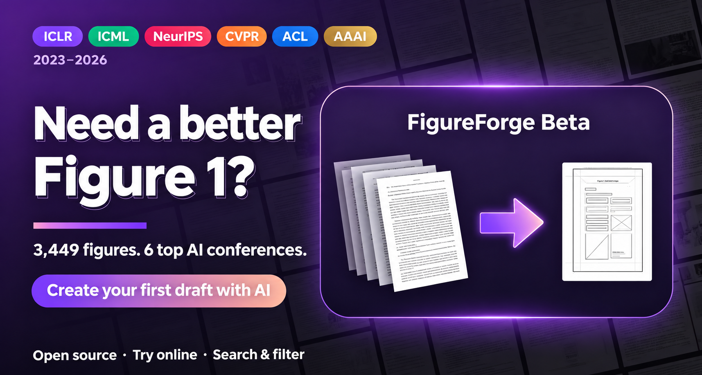

<div align="center">

<p align="center">🌐 <a href="README.md">简体中文</a> · <a href="README.en.md">English</a> · <strong>Français</strong> · <a href="README.ru.md">Русский</a> · <a href="README.ko.md">한국어</a> · <a href="README.ja.md">日本語</a></p>


# 🎨 Galerie de figures des grandes conférences
### Inspiration pour la figure principale des articles en IA · ICLR · ICML · NeurIPS · CVPR · ACL · AAAI · 2023–2026

### 💖 Soutien financier et ressources

Aidez à maintenir une source ouverte d’inspiration pour les figures scientifiques et à développer les outils. Particuliers et organismes peuvent soutenir la maintenance, le développement de FigureForge et son évaluation par un financement, des crédits API, du calcul GPU ou des ressources cloud. Les contributions de code, suggestions d’articles et partages sont également bienvenus.

**Proposer un parrainage ou des ressources: [939123836@qq.com](mailto:939123836@qq.com)**


### ✨ Exemples générés avec FigureForge

Figures réellement produites avec FigureForge, avec export des détails modifiables.

<table>
<tr><td width="50%" align="center"><a href="docs/figureforge-examples/robot-policy.png"></a><br><strong>Politique robotique et exécution</strong></td><td width="50%" align="center"><a href="docs/figureforge-examples/controllable-video-generation.jpg"></a><br><strong>Génération vidéo contrôlable par Transformer de diffusion spatiotemporelle</strong></td></tr>
<tr><td width="50%" align="center"><a href="docs/figureforge-examples/reed-straw-slurry.jpg"></a><br><strong>Stabilité et rhéologie de suspensions de tiges de roseau broyées par voie humide</strong></td><td width="50%" align="center"><a href="docs/figureforge-examples/sycophancy-analysis.png"></a><br><strong>Analyse causale de la complaisance des LLM</strong></td></tr>
</table>

[](https://qwdwqfwq.github.io/topconf-paper-figure-gallery/)


[](requirements.txt)
[](LICENSE)
[-yellow.svg)](IMAGES_POLICY.md)
[](CONTRIBUTING.md)


<p align="center">🌐 <a href="README.md">简体中文</a> · <a href="README.en.md">English</a> · <strong>Français</strong> · <a href="README.ru.md">Русский</a> · <a href="README.ko.md">한국어</a> · <a href="README.ja.md">日本語</a></p>

<p align="center">
  <a href="https://atomgit.com/LiXiao-buaa/topconf-paper-figure-gallery"></a>
  <a href="https://github.com/qwdwqfwq/topconf-paper-figure-gallery"></a>
</p>

**[Dépôt miroir sur AtomGit en Chine](https://atomgit.com/LiXiao-buaa/topconf-paper-figure-gallery)**

Avant de dessiner votre figure principale, découvrez la composition des figures des grandes conférences. Une galerie de figures 1 et d’illustrations de présentation, avec recherche et filtres. Site statique sans compilation ; la galerie peut être ouverte hors ligne.

[Galerie en ligne](https://qwdwqfwq.github.io/topconf-paper-figure-gallery/) · [Dessiner avec FigureForge](https://qwdwqfwq.github.io/topconf-paper-figure-gallery/forge/) · [Vidéo de démonstration](https://qwdwqfwq.github.io/topconf-paper-figure-gallery/docs/demo.html) · [Données et méthode](docs/METHODOLOGY.md) · [Droits / retrait](IMAGES_POLICY.md) · [Guide de contribution](CONTRIBUTING.md)

</div>

## 🤝 Partenaires

Ces partenaires soutiennent le projet avec des API de modèles et des ressources de calcul. Cliquez sur une bannière ; dépliez les détails pour en savoir plus.

<table>
<tr>
<td width="50%" valign="top"><a href="https://www.infistar.cc/register?aff=RZ4MDTRU&amp;ref_source=link"><strong>Infistar.cc</strong></a><br><a href="https://www.infistar.cc/register?aff=RZ4MDTRU&amp;ref_source=link"></a><br><a href="https://www.infistar.cc/register?aff=RZ4MDTRU&amp;ref_source=link">S’inscrire : crédit d’essai de 5 ¥ ↗</a><details><summary>Présentation et offres</summary><ul><li>Accès à Claude, OpenAI, DeepSeek et à d’autres modèles pour le code TikZ / Python, la révision d’articles et l’analyse de figures.</li><li>Certains modèles sont annoncés à partir de 1 % du tarif officiel ; consultez les prix actuels de la plateforme.</li><li>Prise en charge de fortes concurrences et de la facturation ; disponibilité et limites selon l’état du service.</li><li>Le lien partenaire propose 5 ¥ de crédit d’essai et des offres de premier paiement, selon les conditions de la campagne.</li></ul></details></td>
<td width="50%" valign="top"><a href="https://www.aiyoyoo.com/register?aff=SAD34WPXTQWU"><strong>CrazyToken</strong></a><br><a href="https://www.aiyoyoo.com/register?aff=SAD34WPXTQWU"></a><br><a href="https://www.aiyoyoo.com/register?aff=SAD34WPXTQWU">S’inscrire : crédit d’essai de 20 $ ↗</a><details><summary>Présentation et offres</summary><ul><li>Tarifs annoncés à partir de 0,05× le prix officiel, avec facturation par jeton.</li><li>Claude, GPT, Gemini, Kimi, GLM, DeepSeek, Qwen et Grok pour comprendre les articles, coder des figures et réviser l’anglais.</li><li>Le fournisseur annonce des canaux officiels natifs, sans substitution de modèle ni compression du contexte long.</li><li>Associez les références des conférences à FigureForge pour analyser, générer et améliorer les compositions.</li><li>Offre annoncée de 20 $ à l’inscription, bonus de recharge et aide individuelle à la configuration à distance.</li></ul></details></td>
</tr>
  <tr>
    <td width="50%" valign="top">
      <a href="https://nonelinear.com.cn/"><strong>Nonelinear API</strong></a><br>
      <a href="https://nonelinear.com.cn/"></a><br>
      <sub>API de modèles · Figures scientifiques｜<a href="https://nonelinear.com.cn/"><strong>Code « 灵感画廊 » : crédit d’essai de 20 ¥ ↗</strong></a></sub>
      <details>
        <summary><sub>Présentation et offres</sub></summary>
        <p>Merci à Nonelinear API (nonelinear.com.cn) pour son soutien au projet en ressources API de modèles multimodaux !</p>
        <ul>
          <li><strong>Modèles de pointe réunis</strong>：Le partenaire annonce l’accès sans VPN à Claude, GPT, DeepSeek et à d’autres modèles via des canaux officiels complets, pour générer des figures, réviser des articles et analyser des graphiques complexes.</li>
          <li><strong>Réduction des coûts</strong>：Taux de succès du cache annoncé jusqu’à 98 %, pour réduire les coûts en jetons des articles longs et du raisonnement intensif.</li>
          <li><strong>Forte concurrence</strong>：Réponses annoncées en millisecondes et prise en charge de la facturation.</li>
          <li><strong>Offre d’essai exclusive</strong>：Contactez le service client avec le code « 灵感画廊 » pour 20 ¥ de crédit d’essai et des offres de premier paiement.</li>
        </ul>
        <p>Tutoriel de configuration et d’utilisation：<a href="https://docs.nonelinear.com.cn/scenes/overview">Guide de démarrage rapide Nonelinear API ↗</a></p>
      </details>
    </td>
    <td width="50%" valign="top"></td>
  </tr>
</table>

<sub>Les descriptions promotionnelles sont fournies par les partenaires. Prix, disponibilité des modèles, crédits et conditions dépendent des pages officielles actuelles de chaque service.</sub>

## Présentation

Cette galerie rassemble les figures 1 et les illustrations de présentation de six conférences majeures en ML / IA, de 2023 à 2026 : concepts, systèmes, processus, architectures et vues d’ensemble. Elle sert de référence de composition, sans classer les articles. Chaque carte renvoie à la publication et indique conférence, année, auteurs et type visuel.

- Filtrez par conférence, année, niveau de sélection et type visuel ; grille en cascade et visionneuse agrandie.
- Les figures Oral, Spotlight et Best / Outstanding portent des badges or, argent et rouge pour les années indexées d’ICLR, ICML et NeurIPS.
- Recherchez titres, auteurs et mots-clés, par exemple `DPO`, `robot`, `gaussian` ou `agent`.
- Chaque figure est vérifiée manuellement après plus de 25 règles éliminant graphiques matplotlib par défaut, tableaux simples, captures d’interface et assemblages de photos sans annotations. Voir la [méthode](docs/METHODOLOGY.md).
- Galerie statique, sans serveur applicatif ni compilation.
- Chaîne reproductible : index des actes → téléchargement PDF → recadrage de la figure 1 → score de qualité → dédoublonnage dHash → vérification manuelle.

### 🛠️ FigureForge Beta

Décrivez votre article et utilisez 3 452 figures comme références de composition pour créer une première version. Sans inscription ; le flux s’exécute dans votre navigateur avec votre clé API. **[Essayer FigureForge →](https://qwdwqfwq.github.io/topconf-paper-figure-gallery/forge/)**

<p align="center"></p>

**[▶ Démonstration complète · 3 min 23 · avec son](https://qwdwqfwq.github.io/topconf-paper-figure-gallery/docs/demo.html)**

[](https://qwdwqfwq.github.io/topconf-paper-figure-gallery/docs/demo.html)

1. **Décrire l’article :** collez titre et résumé, importez un PDF que le modèle de l’étape 1 lit pour résumer les sections pertinentes, ou décrivez entrée → méthode → sortie.

2. **Choisir un type :** `framework` pour les systèmes et agents, `pipeline` pour les processus, `architecture` pour les structures internes, `conceptual` pour les métaphores ; également `teaser` et `taxonomy`.

3. **Sélectionner des références :** recherche CLIP + BM25 sur les 3 452 figures, avec score de pertinence. Au moins 4 références du même type en mode deux phases, jusqu’à 10 ; 2–4 en mode direct.

   

4. **Analyser puis générer :** le modèle visuel résume composition, éléments, couleurs et hiérarchie, sélectionne 4–6 figures représentatives, puis génère.

   

5. **Choisir un mode, saisir la clé (recommandé : [Nonelinear API](https://nonelinear.com.cn), accessible sans VPN ; indiquez「灵感画廊」pour recevoir 20 yuans de crédit) et télécharger :** le SVG permet de modifier le texte dans Figma / draw.io / Illustrator ; le mode bitmap fournit une composition à vérifier dans PPT / Figma. La clé reste dans votre navigateur local.

> FigureForge s’appuie sur des figures de conférence pour conserver la grille des panneaux, la narration comparative et une palette sobre.

> 

### Proposer un article ou une figure

Ouvrez une issue [Suggest a figure](https://github.com/qwdwqfwq/topconf-paper-figure-gallery/issues/new?template=add-figure-request.md) avec le lien de l’article. Aucun code nécessaire. Pour une PR, consultez [CONTRIBUTING.md](CONTRIBUTING.md). Les conférences CHI / RSS / CoRL et autres sont bienvenues.

## 📊 Couverture

| Conférence | 2023 | 2024 | 2025 | 2026 | Figures | Best / Outstanding | Oral | Spotlight | Total par niveau |
|---|---:|---:|---:|---:|---:|---:|---:|---:|---:|
| 🟣 **ICLR** | 108 | 135 | 274 | 228 | **745** | 10 | 337 | 155 | **502** |
| 🟢 **ICML** | 63 | 131 | 216 | 338 | **748** | 13 | 247 | 558 | **818** |
| 🔴 **NeurIPS** | 236 | 363 | 367 | — | **966** | 3 | 32 | 237 | **272** |
| 🟠 **CVPR** | 65 | 64 | 96 | 83 | **308** | — | — | — | — |
| 🔵 **ACL** | 84 | 74 | 168 | 58 | **384** | — | — | — | — |
| 🟡 **AAAI** | 59 | 66 | 139 | 37 | **301** | — | — | — | — |
| **Total** | | | | | **3452** | **26** | **616** | **950** | **1592** |

Statistiques par niveau : ICLR et ICML 2023–2026 ; NeurIPS 2023–2025. — signifie non indexé.

## 🧭 Types visuels

Les types décrivent la fonction visuelle, pas le domaine scientifique.

| Type | Signification | Exemples |
|---|---|---|
| `conceptual` | Métaphore visuelle d’une idée centrale | DPO, Tree of Thoughts, HippoRAG |
| `framework` | Vue d’ensemble d’un système ou d’agents | HuggingGPT, SWE-agent, MetaGPT |
| `pipeline` | Flux de données par étapes | LRM, VidMan, LiveStar |
| `architecture` | Couches internes et connexions des tenseurs | BLIP-2, Caduceus, Medusa |
| `taxonomy` | Vue d’ensemble des tâches, capacités ou données | EmbodiedBench, SimWorld |
| `teaser` | Composition conçue d’images et de texte | VIMA, PixArt-α |

## 🚀 Démarrage rapide

Consulter en ligne: [GitHub Pages](https://qwdwqfwq.github.io/topconf-paper-figure-gallery/).

Exécuter localement:

```bash
git clone https://github.com/qwdwqfwq/topconf-paper-figure-gallery.git
cd topconf-paper-figure-gallery
python -m http.server 8000
```

[http://localhost:8000](http://localhost:8000)

Vous pouvez aussi ouvrir `index.html` directement ; les métadonnées sont intégrées dans `assets/figures.js`, sans connexion requise pour la galerie.

## 🗃️ Structure du dépôt

```text
├── index.html
├── assets/
│   ├── style.css / app.js
│   └── figures.js
├── images/<venue>/final/
├── data/
│   ├── figures.json
│   └── pool/
├── scripts/
├── docs/
├── forge/
└── .github/workflows/
```

## 🔧 Chaîne de données et reproduction

Voir [docs/METHODOLOGY.md](docs/METHODOLOGY.md).

```bash
pip install -r requirements.txt
python scripts/build_pool.py
python scripts/extract_all.py
python scripts/build_pool_new.py cvpr,acl,aaai
python scripts/extract_new.py cvpr,acl,aaai 12
python scripts/score_select.py 980
python scripts/assemble_gallery.py 1000
python scripts/clean_stale.py
python scripts/enum_sheets.py iclr
python scripts/sheet_qa.py 31
```

### 🌟 Contributeurs

Contributions communautaires intégrées, par ordre d’adoption.

| Contributeur | Contribution | PR |
|---|---|---|
| [@timelic](https://github.com/timelic) | Transitions d’éléments partagés de la visionneuse ; auteurs, liens image / article, badges, coins arrondis et séparateurs. | [#2](https://github.com/qwdwqfwq/topconf-paper-figure-gallery/pull/2) · [#3](https://github.com/qwdwqfwq/topconf-paper-figure-gallery/pull/3) |
| [@TansyZenix](https://github.com/TansyZenix) | Gestion du focus, isolation sandbox des aperçus SVG, sélection au clavier et états ARIA des références, validation des données en CI. | [#5](https://github.com/qwdwqfwq/topconf-paper-figure-gallery/pull/5) · [#6](https://github.com/qwdwqfwq/topconf-paper-figure-gallery/pull/6) · [#7](https://github.com/qwdwqfwq/topconf-paper-figure-gallery/pull/7) · [#8](https://github.com/qwdwqfwq/topconf-paper-figure-gallery/pull/8) |

## ⚠️ Droits d’auteur

Les figures appartiennent à leurs auteurs et éditeurs. Le dépôt constitue un index attribué pour l’éducation et la recherche non commerciales. Voir la politique existante dans [IMAGES_POLICY.md](IMAGES_POLICY.md). Demandez un retrait par issue ou à **939123836@qq.com** ; suppression sous 72 heures après vérification.

## 📌 Citation

```bibtex
@misc{topconf_figure_gallery,
  title  = {Top-Conf Figure Gallery: A Curated Gallery of Figure 1 / Teaser Designs from ICLR, ICML, NeurIPS, CVPR, ACL and AAAI (2023-2026)},
  year   = {2026},
  url    = {https://github.com/qwdwqfwq/topconf-paper-figure-gallery}
}
```

<details>
<summary><strong>🖼️ Catalogue sélectionné</strong></summary>

Les deux figures les mieux notées par conférence et année ; les 3 452 figures sont dans la [galerie en ligne](https://qwdwqfwq.github.io/topconf-paper-figure-gallery/).

<br>

**ICLR**


| <a href="https://openreview.net/forum?id=ApF0dmi1_9K"></a><br><sub>2023 · <a href="https://openreview.net/forum?id=ApF0dmi1_9K">NTFields: Neural Time Fields for Physics-Informed Robot Motion Planning</a></sub> | <a href="https://openreview.net/forum?id=qU6NIcpaSi-"></a><br><sub>2023 · <a href="https://openreview.net/forum?id=qU6NIcpaSi-">Learning Heterogeneous Interaction Strengths by Trajectory Prediction with Graph Neural Net…</a></sub> | <a href="https://openreview.net/forum?id=CIj1CVbkpr"></a><br><sub>2024 · <a href="https://openreview.net/forum?id=CIj1CVbkpr">Online Stabilization of Spiking Neural Networks</a></sub> |
|---|---|---|
| <a href="https://openreview.net/forum?id=NxoFmGgWC9"></a><br><sub>2024 · <a href="https://openreview.net/forum?id=NxoFmGgWC9">Unleashing Large-Scale Video Generative Pre-training for Visual Robot Manipulation</a></sub> | <a href="https://openreview.net/forum?id=Y1r9yCMzeA"></a><br><sub>2025 · <a href="https://openreview.net/forum?id=Y1r9yCMzeA">GraphArena: Evaluating and Exploring Large Language Models on Graph Computation</a></sub> | <a href="https://openreview.net/forum?id=vzItLaEoDa"></a><br><sub>2025 · <a href="https://openreview.net/forum?id=vzItLaEoDa">Open-World Reinforcement Learning over Long Short-Term Imagination</a></sub> |

<br>

**ICML**


| <a href="https://proceedings.mlr.press/v202/cho23a.html"></a><br><sub>2023 · <a href="https://proceedings.mlr.press/v202/cho23a.html">Neural Latent Aligner: Cross-trial Alignment for Learning Representations of Complex, Natur…</a></sub> | <a href="https://proceedings.mlr.press/v202/liu23f.html"></a><br><sub>2023 · <a href="https://proceedings.mlr.press/v202/liu23f.html">AudioLDM: Text-to-Audio Generation with Latent Diffusion Models</a></sub> | <a href="https://proceedings.mlr.press/v235/cachet24a.html"></a><br><sub>2024 · <a href="https://proceedings.mlr.press/v235/cachet24a.html">Bridging Environments and Language with Rendering Functions and Vision-Language Models</a></sub> |
|---|---|---|
| <a href="https://proceedings.mlr.press/v235/lee24h.html"></a><br><sub>2024 · <a href="https://proceedings.mlr.press/v235/lee24h.html">Recurrent Early Exits for Federated Learning with Heterogeneous Clients</a></sub> | <a href="https://proceedings.mlr.press/v267/zhang25aq.html"></a><br><sub>2025 · <a href="https://proceedings.mlr.press/v267/zhang25aq.html">Locate-then-edit for Multi-hop Factual Recall under Knowledge Editing</a></sub> | <a href="https://proceedings.mlr.press/v267/li25v.html"></a><br><sub>2025 · <a href="https://proceedings.mlr.press/v267/li25v.html">R*: Efficient Reward Design via Reward Structure Evolution and Parameter Alignment Optimiza…</a></sub> |

<br>

**NeurIPS**


| <a href="https://proceedings.neurips.cc/paper_files/paper/2023/hash/4b0eea69deea512c9e2c469187643dc2-Abstract-Conference.html"></a><br><sub>2023 · <a href="https://proceedings.neurips.cc/paper_files/paper/2023/hash/4b0eea69deea512c9e2c469187643dc2-Abstract-Conference.html">SwiftSage: A Generative Agent with Fast and Slow Thinking for Complex Interactive Tasks</a></sub> | <a href="https://proceedings.neurips.cc/paper_files/paper/2023/hash/88a129e44f25a571ae80673660f8a45cc305c2-Abstract-Conference.html"></a><br><sub>2023 · <a href="https://proceedings.neurips.cc/paper_files/paper/2023/hash/88a129e44f25a571ae80673660f8a45cc305c2-Abstract-Conference.html">LayoutPrompter: Awaken the Design Ability of Large Language Models</a></sub> | <a href="https://proceedings.neurips.cc/paper_files/paper/2024/hash/fe0007fcfd707673660ec0f9014bc48e-Abstract-Datasets_and_Benchmarks_Track.html"></a><br><sub>2024 · <a href="https://proceedings.neurips.cc/paper_files/paper/2024/hash/fe0007fcfd707673660ec0f9014bc48e-Abstract-Datasets_and_Benchmarks_Track.html">A survey and benchmark of high-dimensional Bayesian optimization of discrete sequences</a></sub> |
|---|---|---|
| <a href="https://proceedings.neurips.cc/paper_files/paper/2024/hash/237ffa9a473effc66d085dba7f813ba-Abstract-Datasets_and_Benchmarks_Track.html"></a><br><sub>2024 · <a href="https://proceedings.neurips.cc/paper_files/paper/2024/hash/237ffa9a473effc66d085dba7f813ba-Abstract-Datasets_and_Benchmarks_Track.html">Task Me Anything</a></sub> | <a href="https://arxiv.org/abs/2509.21927"></a><br><sub>2025 · <a href="https://arxiv.org/abs/2509.21927">SingRef6D: Monocular Novel Object Pose Estimation with a Single RGB Reference</a></sub> | <a href="https://openreview.net/forum?id=aSfBbhUJAa"></a><br><sub>2025 · <a href="https://openreview.net/forum?id=aSfBbhUJAa">RepoMaster: Autonomous Exploration and Understanding of GitHub Repositories for Complex Tas…</a></sub> |

<br>

**CVPR**


| <a href="https://openaccess.thecvf.com/content/CVPR2023/html/Chen_TrojDiff_Trojan_Attacks_on_Diffusion_Models_With_Diverse_Targets_CVPR_2023_paper.html"></a><br><sub>2023 · <a href="https://openaccess.thecvf.com/content/CVPR2023/html/Chen_TrojDiff_Trojan_Attacks_on_Diffusion_Models_With_Diverse_Targets_CVPR_2023_paper.html">TrojDiff: Trojan Attacks on Diffusion Models With Diverse Targets</a></sub> | <a href="https://openaccess.thecvf.com/content/CVPR2023/html/Shao_Detecting_and_Grounding_Multi-Modal_Media_Manipulation_CVPR_2023_paper.html"></a><br><sub>2023 · <a href="https://openaccess.thecvf.com/content/CVPR2023/html/Shao_Detecting_and_Grounding_Multi-Modal_Media_Manipulation_CVPR_2023_paper.html">Detecting and Grounding Multi-Modal Media Manipulation</a></sub> | <a href="https://openaccess.thecvf.com/content/CVPR2024/html/Shou_Learning_Large-Factor_EM_Image_Super-Resolution_with_Generative_Priors_CVPR_2024_paper.html"></a><br><sub>2024 · <a href="https://openaccess.thecvf.com/content/CVPR2024/html/Shou_Learning_Large-Factor_EM_Image_Super-Resolution_with_Generative_Priors_CVPR_2024_paper.html">Learning Large-Factor EM Image Super-Resolution with Generative Priors</a></sub> |
|---|---|---|
| <a href="https://openaccess.thecvf.com/content/CVPR2024/html/Huang_VBench_Comprehensive_Benchmark_Suite_for_Video_Generative_Models_CVPR_2024_paper.html"></a><br><sub>2024 · <a href="https://openaccess.thecvf.com/content/CVPR2024/html/Huang_VBench_Comprehensive_Benchmark_Suite_for_Video_Generative_Models_CVPR_2024_paper.html">VBench: Comprehensive Benchmark Suite for Video Generative Models</a></sub> | <a href="https://openaccess.thecvf.com/content/CVPR2025/html/Jagpal_EIDT-V_Exploiting_Intersections_in_Diffusion_Trajectories_for_Model-Agnostic_Zero-Shot_Training-Free_CVPR_2025_paper.html"></a><br><sub>2025 · <a href="https://openaccess.thecvf.com/content/CVPR2025/html/Jagpal_EIDT-V_Exploiting_Intersections_in_Diffusion_Trajectories_for_Model-Agnostic_Zero-Shot_T…</a></sub> | <a href="https://openaccess.thecvf.com/content/CVPR2025/html/Wang_FSFM_A_Generalizable_Face_Security_Foundation_Model_via_Self-Supervised_Facial_CVPR_2025_paper.html"></a><br><sub>2025 · <a href="https://openaccess.thecvf.com/content/CVPR2025/html/Wang_FSFM_A_Generalizable_Face_Security_Foundation_Model_via_Self-Supervised_Facial_Representat…</a></sub> |

<br>

**ACL**


| <a href="https://aclanthology.org/2023.acl-long.421/"></a><br><sub>2023 · <a href="https://aclanthology.org/2023.acl-long.421/">C on FEDE : Contrastive Feature Decomposition for Multimodal Sentiment Analysis</a></sub> | <a href="https://aclanthology.org/2023.findings-acl.508/"></a><br><sub>2023 · <a href="https://aclanthology.org/2023.findings-acl.508/">Prosody- TTS : Improving Prosody with Masked Autoencoder and Conditional Diffusion Model Fo…</a></sub> | <a href="https://aclanthology.org/2024.findings-acl.155/"></a><br><sub>2024 · <a href="https://aclanthology.org/2024.findings-acl.155/">DELL : Generating Reactions and Explanations for LLM -Based Misinformation Detection</a></sub> |
|---|---|---|
| <a href="https://aclanthology.org/2024.acl-long.360/"></a><br><sub>2024 · <a href="https://aclanthology.org/2024.acl-long.360/">G rounding GPT : Language Enhanced Multi-modal Grounding Model</a></sub> | <a href="https://aclanthology.org/2025.findings-acl.191/"></a><br><sub>2025 · <a href="https://aclanthology.org/2025.findings-acl.191/">N eg VQA : Can Vision Language Models Understand Negation?</a></sub> | <a href="https://aclanthology.org/2025.acl-long.859/"></a><br><br><sub>2025 · <a href="https://aclanthology.org/2025.acl-long.859/">A Troublemaker with Contagious Jailbreak Makes Chaos in Honest Towns</a></sub> |

<br>

**AAAI**


| <a href="https://ojs.aaai.org/index.php/AAAI/article/view/25639"></a><br><sub>2023 · <a href="https://ojs.aaai.org/index.php/AAAI/article/view/25639">MDM: Molecular Diffusion Model for 3D Molecule Generation</a></sub> | <a href="https://ojs.aaai.org/index.php/AAAI/article/view/26628"></a><br><sub>2023 · <a href="https://ojs.aaai.org/index.php/AAAI/article/view/26628">What Does Your Face Sound Like? 3D Face Shape towards Voice</a></sub> | <a href="https://ojs.aaai.org/index.php/AAAI/article/view/27775"></a><br><sub>2024 · <a href="https://ojs.aaai.org/index.php/AAAI/article/view/27775">PosDiffNet: Positional Neural Diffusion for Point Cloud Registration in a Large Field of Vi…</a></sub> |
|---|---|---|
| <a href="https://ojs.aaai.org/index.php/AAAI/article/view/29496"></a><br><sub>2024 · <a href="https://ojs.aaai.org/index.php/AAAI/article/view/29496">Wavelet Dynamic Selection Network for Inertial Sensor Signal Enhancement</a></sub> | <a href="https://ojs.aaai.org/index.php/AAAI/article/view/33754"></a><br><sub>2025 · <a href="https://ojs.aaai.org/index.php/AAAI/article/view/33754">EditBoard: Towards a Comprehensive Evaluation Benchmark for Text-Based Video Editing Models</a></sub> | <a href="https://ojs.aaai.org/index.php/AAAI/article/view/33863"></a><br><sub>2025 · <a href="https://ojs.aaai.org/index.php/AAAI/article/view/33863">Enhancing Multivariate Time-Series Domain Adaptation via Contrastive Frequency Graph Discov…</a></sub> |

<sub>Les figures appartiennent à leurs auteurs et éditeurs. Cliquez sur une image pour ouvrir l’article source.</sub>

</details>


## ⭐ Historique des étoiles

<a href="https://star-history.com/#qwdwqfwq/topconf-paper-figure-gallery&Date">
  <picture>
    <source media="(prefers-color-scheme: dark)" srcset="https://api.star-history.com/svg?repos=qwdwqfwq/topconf-paper-figure-gallery&type=Date&theme=dark" />
    <source media="(prefers-color-scheme: light)" srcset="https://api.star-history.com/svg?repos=qwdwqfwq/topconf-paper-figure-gallery&type=Date" />
    
  </picture>
</a>


## ♡ Soutenir l’auteur

### Offrir un café à l’auteur ☕

Si la galerie vous a inspiré, les dons facultatifs soutiennent la sélection des figures, les mises à jour et la maintenance des outils.

<table>
<tr><td align="center"><strong>WeChat Pay</strong><br><a href="assets/wechat-pay.jpg"></a></td><td align="center"><strong>Alipay</strong><br><a href="assets/alipay-pay.jpg"></a></td></tr>
</table>

<sub>Cliquez sur un code pour afficher l’original. Sur mobile, enregistrez-le puis sélectionnez-le dans l’album du scanner de votre application de paiement.</sub>

Les dons sont libres et facultatifs. Étoiles, partages et retours sont également appréciés.
