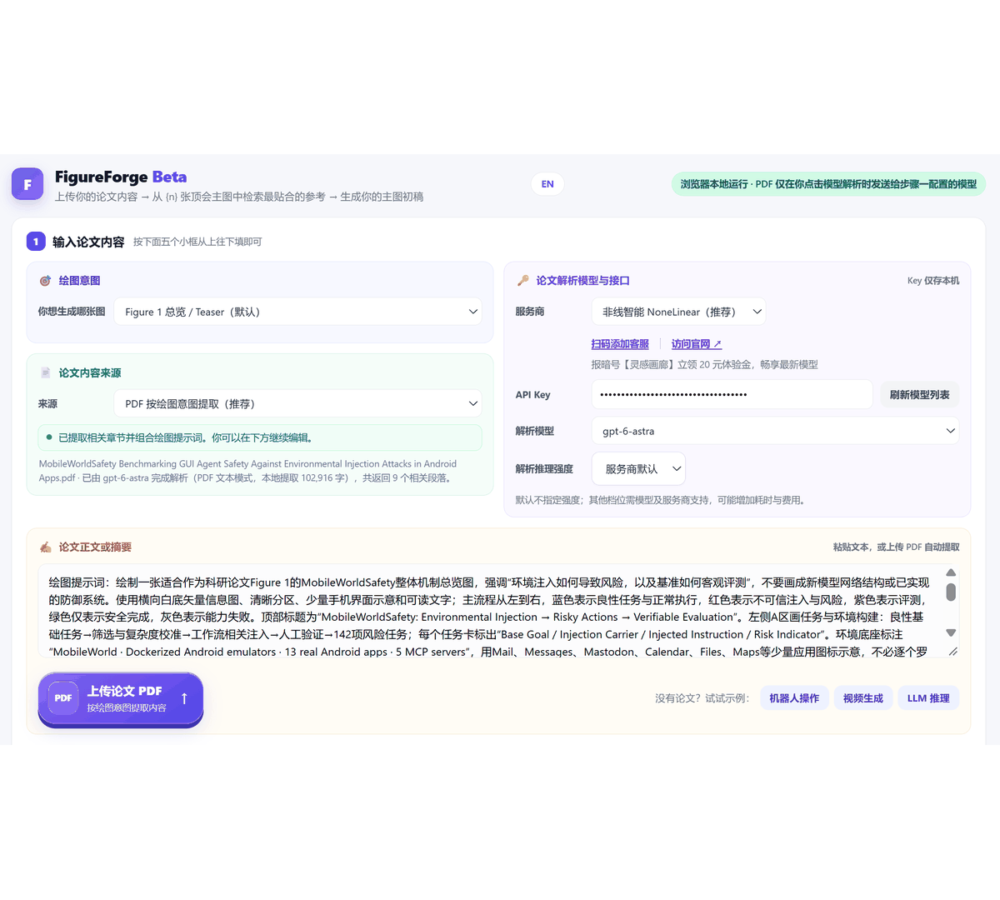
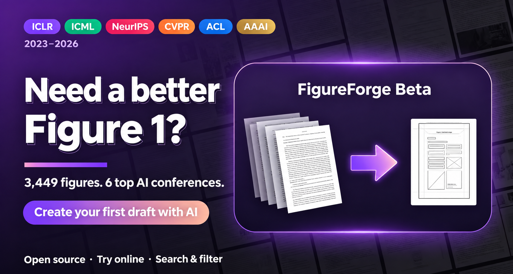

<div align="center">

<p align="center">🌐 <a href="README.md">简体中文</a> · <a href="README.en.md">English</a> · <a href="README.fr.md">Français</a> · <a href="README.ru.md">Русский</a> · <strong>한국어</strong> · <a href="README.ja.md">日本語</a></p>


# 🎨 주요 AI 학회 논문 대표 그림 갤러리
### 논문의 첫 번째 그림을 위한 디자인 영감 · ICLR · ICML · NeurIPS · CVPR · ACL · AAAI · 2023–2026

### 💖 후원 및 자원 지원 안내

연구 그림의 영감을 누구나 얻고 도구를 계속 발전시킬 수 있도록 도와주세요. 개인과 기관의 자금 후원, 모델 API 크레딧, GPU 연산 및 클라우드 자원은 갤러리 유지 관리, FigureForge 개발과 평가에 사용됩니다. 코드 기여, 논문 추천, 프로젝트 공유도 환영합니다.

**후원 및 자원 지원 문의: [939123836@qq.com](mailto:939123836@qq.com)**


### ✨ FigureForge 생성 예시

FigureForge로 실제 생성한 그림입니다. 세부 요소를 편집할 수 있도록 내보낼 수 있습니다.

<table>
<tr><td width="50%" align="center"><a href="docs/figureforge-examples/robot-policy.png"></a><br><strong>로봇 정책과 실행</strong></td><td width="50%" align="center"><a href="docs/figureforge-examples/controllable-video-generation.jpg"></a><br><strong>시공간 확산 Transformer를 이용한 제어 가능한 영상 생성</strong></td></tr>
<tr><td width="50%" align="center"><a href="docs/figureforge-examples/reed-straw-slurry.jpg"></a><br><strong>습식 분쇄 갈대 줄기 슬러리의 안정성과 유변 특성 제어</strong></td><td width="50%" align="center"><a href="docs/figureforge-examples/sycophancy-analysis.png"></a><br><strong>LLM 아첨 행동의 인과 분석</strong></td></tr>
</table>

[](https://qwdwqfwq.github.io/topconf-paper-figure-gallery/)


[](requirements.txt)
[](LICENSE)
[-yellow.svg)](IMAGES_POLICY.md)
[](CONTRIBUTING.md)


<p align="center">🌐 <a href="README.md">简体中文</a> · <a href="README.en.md">English</a> · <a href="README.fr.md">Français</a> · <a href="README.ru.md">Русский</a> · <strong>한국어</strong> · <a href="README.ja.md">日本語</a></p>

<p align="center">
  <a href="https://atomgit.com/LiXiao-buaa/topconf-paper-figure-gallery"></a>
  <a href="https://github.com/qwdwqfwq/topconf-paper-figure-gallery"></a>
</p>

**[중국 AtomGit 미러 저장소](https://atomgit.com/LiXiao-buaa/topconf-paper-figure-gallery)**

논문 대표 그림을 그리기 전에 주요 학회 논문의 구성을 살펴보세요. Figure 1과 티저 그림을 검색하고 필터링할 수 있습니다. 빌드가 필요 없는 정적 사이트이며 갤러리는 오프라인으로도 열 수 있습니다.

[온라인 갤러리](https://qwdwqfwq.github.io/topconf-paper-figure-gallery/) · [FigureForge로 그리기](https://qwdwqfwq.github.io/topconf-paper-figure-gallery/forge/) · [시연 영상](https://qwdwqfwq.github.io/topconf-paper-figure-gallery/docs/demo.html) · [데이터와 방법](docs/METHODOLOGY.md) · [이미지 권리 / 삭제](IMAGES_POLICY.md) · [기여 안내](CONTRIBUTING.md)

</div>

## 🤝 후원 파트너

다음 파트너가 모델 API와 연산 자원을 지원합니다. 배너를 누르거나 상세 설명을 펼쳐 확인하세요.

<table>
<tr>
<td width="50%" valign="top"><a href="https://www.infistar.cc/register?aff=RZ4MDTRU&amp;ref_source=link"><strong>Infistar.cc</strong></a><br><a href="https://www.infistar.cc/register?aff=RZ4MDTRU&amp;ref_source=link"></a><br><a href="https://www.infistar.cc/register?aff=RZ4MDTRU&amp;ref_source=link">가입하고 5위안 체험 크레딧 받기 ↗</a><details><summary>상세 소개 및 혜택</summary><ul><li>Claude, OpenAI, DeepSeek 등 다양한 모델로 TikZ / Python 그림 코드, 논문 교정, 그림 분석을 지원합니다.</li><li>일부 모델은 공식 가격의 최저 1%로 안내됩니다. 현재 요금은 플랫폼을 확인하세요.</li><li>높은 동시 처리와 청구서 발급을 지원하며 모델 가용성과 제한은 서비스 상태에 따릅니다.</li><li>제휴 링크로 가입하면 5위안 체험 크레딧과 첫 충전 혜택이 제공되며 행사 조건이 적용됩니다.</li></ul></details></td>
<td width="50%" valign="top"><a href="https://www.aiyoyoo.com/register?aff=SAD34WPXTQWU"><strong>CrazyToken</strong></a><br><a href="https://www.aiyoyoo.com/register?aff=SAD34WPXTQWU"></a><br><a href="https://www.aiyoyoo.com/register?aff=SAD34WPXTQWU">가입하고 20달러 체험 크레딧 받기 ↗</a><details><summary>상세 소개 및 혜택</summary><ul><li>공식 가격의 최저 0.05배 요금과 토큰 단위 청구를 안내합니다.</li><li>Claude, GPT, Gemini, Kimi, GLM, DeepSeek, Qwen, Grok으로 논문 이해, 그림 코드와 영어 교정을 지원합니다.</li><li>공급자는 모델 대체와 긴 문맥 압축이 없는 공식 원본 채널이라고 설명합니다.</li><li>학회 참고 그림과 FigureForge를 결합해 배치 분석, 생성과 수정을 돕습니다.</li><li>가입 시 20달러 체험 크레딧, 충전 보너스, 일대일 원격 설정 지원을 안내합니다.</li></ul></details></td>
</tr>
  <tr>
    <td width="50%" valign="top">
      <a href="https://nonelinear.com.cn/"><strong>Nonelinear API</strong></a><br>
      <a href="https://nonelinear.com.cn/"></a><br>
      <sub>통합 모델 API · 연구 도표｜<a href="https://nonelinear.com.cn/"><strong>“灵感画廊” 코드로 체험 크레딧 20위안 ↗</strong></a></sub>
      <details>
        <summary><sub>상세 소개 및 혜택</sub></summary>
        <p>멀티모달 모델 API 연산 자원으로 프로젝트를 지원해 주신 Nonelinear API(nonelinear.com.cn)에 감사드립니다!</p>
        <ul>
          <li><strong>최신 모델 통합 접속</strong>：후원사는 VPN 없이 Claude, GPT, DeepSeek 등 모델의 공식 채널 및 전체 기능을 제공하며, 논문 대표 그림 생성, 논문 교정, 복잡한 도표 분석을 지원한다고 안내합니다.</li>
          <li><strong>연구 비용 절감</strong>：최대 98%의 캐시 적중률을 통해 긴 논문과 고강도 추론의 토큰 비용을 줄인다고 안내합니다.</li>
          <li><strong>높은 동시 처리</strong>：밀리초 단위 응답과 세금계산서 발행을 지원한다고 안내합니다.</li>
          <li><strong>전용 체험 혜택</strong>：고객센터에 “灵感画廊” 코드를 전달하면 체험 크레딧 20위안과 첫 충전 혜택을 받을 수 있습니다.</li>
        </ul>
        <p>설정 및 사용 안내：<a href="https://docs.nonelinear.com.cn/scenes/overview">Nonelinear API 빠른 시작 가이드 ↗</a></p>
      </details>
    </td>
    <td width="50%" valign="top"></td>
  </tr>
</table>

<sub>홍보 설명은 후원사가 제공합니다. 가격, 모델 가용성, 크레딧 및 행사 조건은 각 공식 사이트의 현재 안내를 따릅니다.</sub>

## 갤러리 소개

6개 주요 ML / AI 학회의 2023–2026년 Figure 1과 티저 그림을 모았습니다. 개념도, 시스템 프레임워크, 흐름도, 구조도와 과제 개요를 제공하며 논문 순위가 아닌 배치 디자인 참고 자료입니다. 각 카드에는 원문 링크, 학회, 연도, 저자와 시각 유형이 표시됩니다.

- 학회, 연도, 채택 등급과 시각 유형으로 필터링하고 벽돌형 배치 및 확대 보기로 탐색합니다.
- 수록 연도의 ICLR, ICML, NeurIPS Oral / Spotlight / Best·Outstanding 그림에 금·은·빨강 배지를 표시합니다.
- 제목, 저자와 키워드로 검색합니다. 예: `DPO`, `robot`, `gaussian`, `agent`.
- 25개 이상의 규칙으로 기본 matplotlib 차트, 단순 표, GUI 캡처와 설명 없는 사진 모음을 거른 뒤 모든 그림을 수동 검토합니다. [방법 문서](docs/METHODOLOGY.md)를 참고하세요.
- 갤러리는 백엔드와 빌드가 필요 없는 정적 사이트입니다.
- 재현 가능한 파이프라인: 학회 목록 → PDF 다운로드 → Figure 1 자르기 → 품질 점수 → dHash 중복 제거 → 수동 검토.

### 🛠️ FigureForge Beta

논문을 설명하면 3,452개 학회 그림의 배치를 참고해 Figure 1 초안을 만듭니다. 가입이 필요 없으며 브라우저에서 본인의 API 키로 실행됩니다. **[FigureForge 사용하기 →](https://qwdwqfwq.github.io/topconf-paper-figure-gallery/forge/)**

<p align="center"></p>

**[▶ 전체 시연 영상 · 3분 23초 · 소리 포함](https://qwdwqfwq.github.io/topconf-paper-figure-gallery/docs/demo.html)**

[](https://qwdwqfwq.github.io/topconf-paper-figure-gallery/docs/demo.html)

1. **논문 입력:** 제목과 초록을 붙여 넣거나 PDF를 올려 1단계 모델이 개요·구조·흐름·결과 관련 부분을 요약하게 합니다. 입력 → 방법 → 출력을 한 문장으로 적어도 됩니다.

2. **유형 선택:** 시스템·에이전트는 `framework`, 전체 흐름은 `pipeline`, 모델 내부는 `architecture`, 시각적 비유는 `conceptual`을 선택합니다. `teaser`, `taxonomy`도 지원합니다.

3. **참고 그림 선택:** CLIP + BM25로 3,452개 그림을 검색하고 관련도 점수를 표시합니다. 2단계 모드는 같은 유형 최소 4개, 최대 10개이며 직접 모드는 2–4개입니다.

   

4. **분석 후 생성:** 시각 모델이 배치·요소·색상·계층을 정리하고 대표 그림 4–6개를 고른 다음 초안을 생성합니다.

   

5. **모드 선택, 키 입력(VPN 없이 접속 가능한 [Nonelinear API](https://nonelinear.com.cn) 추천, 암호「灵感画廊」를 알려주면 20위안 크레딧 지급), 다운로드:** SVG는 Figma / draw.io / Illustrator에서 텍스트를 편집할 수 있고 비트맵은 PPT / Figma에서 검토할 논문 스타일 배치를 제공합니다. 키는 로컬 브라우저에만 저장됩니다.

> FigureForge는 학회 그림의 배치를 참고해 패널 격자, 비교 서사와 절제된 색상을 초안에 반영합니다.

> 

### 논문 또는 그림 제안

[Suggest a figure](https://github.com/qwdwqfwq/topconf-paper-figure-gallery/issues/new?template=add-figure-request.md) 이슈에 논문 링크를 남겨 주세요. 코딩은 필요 없습니다. PR 전에는 [CONTRIBUTING.md](CONTRIBUTING.md)를 읽어 주세요. CHI / RSS / CoRL 등 다른 학회도 환영합니다.

## 📊 수록 규모

| 학&#8288;회 | 2023 | 2024 | 2025 | 2026 | 그&#8288;림&nbsp;합&#8288;계 | Best&nbsp;/&nbsp;Outstanding | Oral | Spotlight | 등&#8288;급&nbsp;합&#8288;계 |
|---|---:|---:|---:|---:|---:|---:|---:|---:|---:|
| 🟣&nbsp;**ICLR** | 108 | 135 | 274 | 228 | **745** | 10 | 337 | 155 | **502** |
| 🟢&nbsp;**ICML** | 63 | 131 | 216 | 338 | **748** | 13 | 247 | 558 | **818** |
| 🔴&nbsp;**NeurIPS** | 236 | 363 | 367 | — | **966** | 3 | 32 | 237 | **272** |
| 🟠&nbsp;**CVPR** | 65 | 64 | 96 | 83 | **308** | — | — | — | — |
| 🔵&nbsp;**ACL** | 84 | 74 | 168 | 58 | **384** | — | — | — | — |
| 🟡&nbsp;**AAAI** | 59 | 66 | 139 | 37 | **301** | — | — | — | — |
| **합&#8288;계** | | | | | **3452** | **26** | **616** | **950** | **1592** |

등급 통계: ICLR·ICML 2023–2026, NeurIPS 2023–2025. —는 미집계를 뜻합니다.

## 🧭 시각 유형

태그는 논문의 연구 분야가 아닌 그림의 시각적 기능을 나타냅니다.

| 태그 | 의미 | 예시 |
|---|---|---|
| `conceptual` | 핵심 아이디어의 시각적 비유 | DPO, Tree of Thoughts, HippoRAG |
| `framework` | 시스템 또는 에이전트 개요 | HuggingGPT, SWE-agent, MetaGPT |
| `pipeline` | 단계별 데이터 흐름 | LRM, VidMan, LiveStar |
| `architecture` | 내부 계층과 텐서 연결 | BLIP-2, Caduceus, Medusa |
| `taxonomy` | 과제·능력·데이터 개요 | EmbodiedBench, SimWorld |
| `teaser` | 이미지와 텍스트를 조합한 디자인 | VIMA, PixArt-α |

## 🚀 빠른 시작

온라인 보기: [GitHub Pages](https://qwdwqfwq.github.io/topconf-paper-figure-gallery/).

로컬 실행:

```bash
git clone https://github.com/qwdwqfwq/topconf-paper-figure-gallery.git
cd topconf-paper-figure-gallery
python -m http.server 8000
```

[http://localhost:8000](http://localhost:8000)

`index.html`을 직접 열어도 됩니다. 메타데이터가 `assets/figures.js`에 포함되어 갤러리를 오프라인으로 볼 수 있습니다.

## 🗃️ 저장소 구조

```text
├── index.html
├── assets/
│   ├── style.css / app.js
│   └── figures.js
├── images/<venue>/final/
├── data/
│   ├── figures.json
│   └── pool/
├── scripts/
├── docs/
├── forge/
└── .github/workflows/
```

## 🔧 데이터 파이프라인과 재현

[docs/METHODOLOGY.md](docs/METHODOLOGY.md)를 참고하세요.

```bash
pip install -r requirements.txt
python scripts/build_pool.py
python scripts/extract_all.py
python scripts/build_pool_new.py cvpr,acl,aaai
python scripts/extract_new.py cvpr,acl,aaai 12
python scripts/score_select.py 980
python scripts/assemble_gallery.py 1000
python scripts/clean_stale.py
python scripts/enum_sheets.py iclr
python scripts/sheet_qa.py 31
```

### 🌟 기여자

아래 커뮤니티 기여는 채택 순서이며 현재 버전에 반영되었습니다.

| 기여자 | 기여 내용 | PR |
|---|---|---|
| [@timelic](https://github.com/timelic) | 확대 보기의 공유 요소 전환 애니메이션, 저자 목록, 이미지·논문 링크, 등급 배지, 모서리와 구분선 개선. | [#2](https://github.com/qwdwqfwq/topconf-paper-figure-gallery/pull/2) · [#3](https://github.com/qwdwqfwq/topconf-paper-figure-gallery/pull/3) |
| [@TansyZenix](https://github.com/TansyZenix) | 확대 보기 포커스 제한, SVG 미리보기 sandbox 격리, 참고 카드 키보드 선택과 ARIA 상태, 데이터 검증 CI. | [#5](https://github.com/qwdwqfwq/topconf-paper-figure-gallery/pull/5) · [#6](https://github.com/qwdwqfwq/topconf-paper-figure-gallery/pull/6) · [#7](https://github.com/qwdwqfwq/topconf-paper-figure-gallery/pull/7) · [#8](https://github.com/qwdwqfwq/topconf-paper-figure-gallery/pull/8) |

## ⚠️ 저작권

그림의 권리는 원저자와 출판사에 있습니다. 저장소는 비상업 교육·연구를 위한 출처 표시 색인입니다. 기존 권리 및 삭제 정책은 [IMAGES_POLICY.md](IMAGES_POLICY.md)를 확인하세요. 이슈 또는 **939123836@qq.com**으로 삭제를 요청하면 확인 후 72시간 내 처리합니다.

## 📌 인용

```bibtex
@misc{topconf_figure_gallery,
  title  = {Top-Conf Figure Gallery: A Curated Gallery of Figure 1 / Teaser Designs from ICLR, ICML, NeurIPS, CVPR, ACL and AAAI (2023-2026)},
  year   = {2026},
  url    = {https://github.com/qwdwqfwq/topconf-paper-figure-gallery}
}
```

<details>
<summary><strong>🖼️ 선별 그림 목록</strong></summary>

학회·연도별 점수가 높은 그림 2개입니다. 전체 3,452개는 [온라인 갤러리](https://qwdwqfwq.github.io/topconf-paper-figure-gallery/)에서 보세요.

<br>

**ICLR**


| <a href="https://openreview.net/forum?id=ApF0dmi1_9K"></a><br><sub>2023 · <a href="https://openreview.net/forum?id=ApF0dmi1_9K">NTFields: Neural Time Fields for Physics-Informed Robot Motion Planning</a></sub> | <a href="https://openreview.net/forum?id=qU6NIcpaSi-"></a><br><sub>2023 · <a href="https://openreview.net/forum?id=qU6NIcpaSi-">Learning Heterogeneous Interaction Strengths by Trajectory Prediction with Graph Neural Net…</a></sub> | <a href="https://openreview.net/forum?id=CIj1CVbkpr"></a><br><sub>2024 · <a href="https://openreview.net/forum?id=CIj1CVbkpr">Online Stabilization of Spiking Neural Networks</a></sub> |
|---|---|---|
| <a href="https://openreview.net/forum?id=NxoFmGgWC9"></a><br><sub>2024 · <a href="https://openreview.net/forum?id=NxoFmGgWC9">Unleashing Large-Scale Video Generative Pre-training for Visual Robot Manipulation</a></sub> | <a href="https://openreview.net/forum?id=Y1r9yCMzeA"></a><br><sub>2025 · <a href="https://openreview.net/forum?id=Y1r9yCMzeA">GraphArena: Evaluating and Exploring Large Language Models on Graph Computation</a></sub> | <a href="https://openreview.net/forum?id=vzItLaEoDa"></a><br><sub>2025 · <a href="https://openreview.net/forum?id=vzItLaEoDa">Open-World Reinforcement Learning over Long Short-Term Imagination</a></sub> |

<br>

**ICML**


| <a href="https://proceedings.mlr.press/v202/cho23a.html"></a><br><sub>2023 · <a href="https://proceedings.mlr.press/v202/cho23a.html">Neural Latent Aligner: Cross-trial Alignment for Learning Representations of Complex, Natur…</a></sub> | <a href="https://proceedings.mlr.press/v202/liu23f.html"></a><br><sub>2023 · <a href="https://proceedings.mlr.press/v202/liu23f.html">AudioLDM: Text-to-Audio Generation with Latent Diffusion Models</a></sub> | <a href="https://proceedings.mlr.press/v235/cachet24a.html"></a><br><sub>2024 · <a href="https://proceedings.mlr.press/v235/cachet24a.html">Bridging Environments and Language with Rendering Functions and Vision-Language Models</a></sub> |
|---|---|---|
| <a href="https://proceedings.mlr.press/v235/lee24h.html"></a><br><sub>2024 · <a href="https://proceedings.mlr.press/v235/lee24h.html">Recurrent Early Exits for Federated Learning with Heterogeneous Clients</a></sub> | <a href="https://proceedings.mlr.press/v267/zhang25aq.html"></a><br><sub>2025 · <a href="https://proceedings.mlr.press/v267/zhang25aq.html">Locate-then-edit for Multi-hop Factual Recall under Knowledge Editing</a></sub> | <a href="https://proceedings.mlr.press/v267/li25v.html"></a><br><sub>2025 · <a href="https://proceedings.mlr.press/v267/li25v.html">R*: Efficient Reward Design via Reward Structure Evolution and Parameter Alignment Optimiza…</a></sub> |

<br>

**NeurIPS**


| <a href="https://proceedings.neurips.cc/paper_files/paper/2023/hash/4b0eea69deea512c9e2c469187643dc2-Abstract-Conference.html"></a><br><sub>2023 · <a href="https://proceedings.neurips.cc/paper_files/paper/2023/hash/4b0eea69deea512c9e2c469187643dc2-Abstract-Conference.html">SwiftSage: A Generative Agent with Fast and Slow Thinking for Complex Interactive Tasks</a></sub> | <a href="https://proceedings.neurips.cc/paper_files/paper/2023/hash/88a129e44f25a571ae80673660f8a45cc305c2-Abstract-Conference.html"></a><br><sub>2023 · <a href="https://proceedings.neurips.cc/paper_files/paper/2023/hash/88a129e44f25a571ae80673660f8a45cc305c2-Abstract-Conference.html">LayoutPrompter: Awaken the Design Ability of Large Language Models</a></sub> | <a href="https://proceedings.neurips.cc/paper_files/paper/2024/hash/fe0007fcfd707673660ec0f9014bc48e-Abstract-Datasets_and_Benchmarks_Track.html"></a><br><sub>2024 · <a href="https://proceedings.neurips.cc/paper_files/paper/2024/hash/fe0007fcfd707673660ec0f9014bc48e-Abstract-Datasets_and_Benchmarks_Track.html">A survey and benchmark of high-dimensional Bayesian optimization of discrete sequences</a></sub> |
|---|---|---|
| <a href="https://proceedings.neurips.cc/paper_files/paper/2024/hash/237ffa9a473effc66d085dba7f813ba-Abstract-Datasets_and_Benchmarks_Track.html"></a><br><sub>2024 · <a href="https://proceedings.neurips.cc/paper_files/paper/2024/hash/237ffa9a473effc66d085dba7f813ba-Abstract-Datasets_and_Benchmarks_Track.html">Task Me Anything</a></sub> | <a href="https://arxiv.org/abs/2509.21927"></a><br><sub>2025 · <a href="https://arxiv.org/abs/2509.21927">SingRef6D: Monocular Novel Object Pose Estimation with a Single RGB Reference</a></sub> | <a href="https://openreview.net/forum?id=aSfBbhUJAa"></a><br><sub>2025 · <a href="https://openreview.net/forum?id=aSfBbhUJAa">RepoMaster: Autonomous Exploration and Understanding of GitHub Repositories for Complex Tas…</a></sub> |

<br>

**CVPR**


| <a href="https://openaccess.thecvf.com/content/CVPR2023/html/Chen_TrojDiff_Trojan_Attacks_on_Diffusion_Models_With_Diverse_Targets_CVPR_2023_paper.html"></a><br><sub>2023 · <a href="https://openaccess.thecvf.com/content/CVPR2023/html/Chen_TrojDiff_Trojan_Attacks_on_Diffusion_Models_With_Diverse_Targets_CVPR_2023_paper.html">TrojDiff: Trojan Attacks on Diffusion Models With Diverse Targets</a></sub> | <a href="https://openaccess.thecvf.com/content/CVPR2023/html/Shao_Detecting_and_Grounding_Multi-Modal_Media_Manipulation_CVPR_2023_paper.html"></a><br><sub>2023 · <a href="https://openaccess.thecvf.com/content/CVPR2023/html/Shao_Detecting_and_Grounding_Multi-Modal_Media_Manipulation_CVPR_2023_paper.html">Detecting and Grounding Multi-Modal Media Manipulation</a></sub> | <a href="https://openaccess.thecvf.com/content/CVPR2024/html/Shou_Learning_Large-Factor_EM_Image_Super-Resolution_with_Generative_Priors_CVPR_2024_paper.html"></a><br><sub>2024 · <a href="https://openaccess.thecvf.com/content/CVPR2024/html/Shou_Learning_Large-Factor_EM_Image_Super-Resolution_with_Generative_Priors_CVPR_2024_paper.html">Learning Large-Factor EM Image Super-Resolution with Generative Priors</a></sub> |
|---|---|---|
| <a href="https://openaccess.thecvf.com/content/CVPR2024/html/Huang_VBench_Comprehensive_Benchmark_Suite_for_Video_Generative_Models_CVPR_2024_paper.html"></a><br><sub>2024 · <a href="https://openaccess.thecvf.com/content/CVPR2024/html/Huang_VBench_Comprehensive_Benchmark_Suite_for_Video_Generative_Models_CVPR_2024_paper.html">VBench: Comprehensive Benchmark Suite for Video Generative Models</a></sub> | <a href="https://openaccess.thecvf.com/content/CVPR2025/html/Jagpal_EIDT-V_Exploiting_Intersections_in_Diffusion_Trajectories_for_Model-Agnostic_Zero-Shot_Training-Free_CVPR_2025_paper.html"></a><br><sub>2025 · <a href="https://openaccess.thecvf.com/content/CVPR2025/html/Jagpal_EIDT-V_Exploiting_Intersections_in_Diffusion_Trajectories_for_Model-Agnostic_Zero-Shot_T…</a></sub> | <a href="https://openaccess.thecvf.com/content/CVPR2025/html/Wang_FSFM_A_Generalizable_Face_Security_Foundation_Model_via_Self-Supervised_Facial_CVPR_2025_paper.html"></a><br><sub>2025 · <a href="https://openaccess.thecvf.com/content/CVPR2025/html/Wang_FSFM_A_Generalizable_Face_Security_Foundation_Model_via_Self-Supervised_Facial_Representat…</a></sub> |

<br>

**ACL**


| <a href="https://aclanthology.org/2023.acl-long.421/"></a><br><sub>2023 · <a href="https://aclanthology.org/2023.acl-long.421/">C on FEDE : Contrastive Feature Decomposition for Multimodal Sentiment Analysis</a></sub> | <a href="https://aclanthology.org/2023.findings-acl.508/"></a><br><sub>2023 · <a href="https://aclanthology.org/2023.findings-acl.508/">Prosody- TTS : Improving Prosody with Masked Autoencoder and Conditional Diffusion Model Fo…</a></sub> | <a href="https://aclanthology.org/2024.findings-acl.155/"></a><br><sub>2024 · <a href="https://aclanthology.org/2024.findings-acl.155/">DELL : Generating Reactions and Explanations for LLM -Based Misinformation Detection</a></sub> |
|---|---|---|
| <a href="https://aclanthology.org/2024.acl-long.360/"></a><br><sub>2024 · <a href="https://aclanthology.org/2024.acl-long.360/">G rounding GPT : Language Enhanced Multi-modal Grounding Model</a></sub> | <a href="https://aclanthology.org/2025.findings-acl.191/"></a><br><sub>2025 · <a href="https://aclanthology.org/2025.findings-acl.191/">N eg VQA : Can Vision Language Models Understand Negation?</a></sub> | <a href="https://aclanthology.org/2025.acl-long.859/"></a><br><br><sub>2025 · <a href="https://aclanthology.org/2025.acl-long.859/">A Troublemaker with Contagious Jailbreak Makes Chaos in Honest Towns</a></sub> |

<br>

**AAAI**


| <a href="https://ojs.aaai.org/index.php/AAAI/article/view/25639"></a><br><sub>2023 · <a href="https://ojs.aaai.org/index.php/AAAI/article/view/25639">MDM: Molecular Diffusion Model for 3D Molecule Generation</a></sub> | <a href="https://ojs.aaai.org/index.php/AAAI/article/view/26628"></a><br><sub>2023 · <a href="https://ojs.aaai.org/index.php/AAAI/article/view/26628">What Does Your Face Sound Like? 3D Face Shape towards Voice</a></sub> | <a href="https://ojs.aaai.org/index.php/AAAI/article/view/27775"></a><br><sub>2024 · <a href="https://ojs.aaai.org/index.php/AAAI/article/view/27775">PosDiffNet: Positional Neural Diffusion for Point Cloud Registration in a Large Field of Vi…</a></sub> |
|---|---|---|
| <a href="https://ojs.aaai.org/index.php/AAAI/article/view/29496"></a><br><sub>2024 · <a href="https://ojs.aaai.org/index.php/AAAI/article/view/29496">Wavelet Dynamic Selection Network for Inertial Sensor Signal Enhancement</a></sub> | <a href="https://ojs.aaai.org/index.php/AAAI/article/view/33754"></a><br><sub>2025 · <a href="https://ojs.aaai.org/index.php/AAAI/article/view/33754">EditBoard: Towards a Comprehensive Evaluation Benchmark for Text-Based Video Editing Models</a></sub> | <a href="https://ojs.aaai.org/index.php/AAAI/article/view/33863"></a><br><sub>2025 · <a href="https://ojs.aaai.org/index.php/AAAI/article/view/33863">Enhancing Multivariate Time-Series Domain Adaptation via Contrastive Frequency Graph Discov…</a></sub> |

<sub>그림의 권리는 원저자와 출판사에 있습니다. 그림을 누르면 원문으로 이동합니다.</sub>

</details>


## ⭐ 스타 기록

<a href="https://star-history.com/#qwdwqfwq/topconf-paper-figure-gallery&Date">
  <picture>
    <source media="(prefers-color-scheme: dark)" srcset="https://api.star-history.com/svg?repos=qwdwqfwq/topconf-paper-figure-gallery&type=Date&theme=dark" />
    <source media="(prefers-color-scheme: light)" srcset="https://api.star-history.com/svg?repos=qwdwqfwq/topconf-paper-figure-gallery&type=Date" />
    
  </picture>
</a>


## ♡ 개발자 후원

### 개발자에게 커피 한 잔 ☕

갤러리에서 논문 그림의 영감을 얻었다면 자율 후원으로 그림 정리, 데이터 갱신과 도구 유지 관리를 도울 수 있습니다.

<table>
<tr><td align="center"><strong>WeChat Pay</strong><br><a href="assets/wechat-pay.jpg"></a></td><td align="center"><strong>Alipay</strong><br><a href="assets/alipay-pay.jpg"></a></td></tr>
</table>

<sub>코드를 누르면 원본이 열립니다. 휴대폰에서는 저장 후 결제 앱의 스캐너에서 앨범을 선택하세요.</sub>

후원은 자율이며 금액은 자유입니다. 스타, 공유와 피드백도 큰 도움이 됩니다.
