<div align="center">

<p align="center">🌐 <strong>简体中文</strong> · <a href="README.en.md">English</a> · <a href="README.fr.md">Français</a> · <a href="README.ru.md">Русский</a> · <a href="README.ko.md">한국어</a> · <a href="README.ja.md">日本語</a></p>

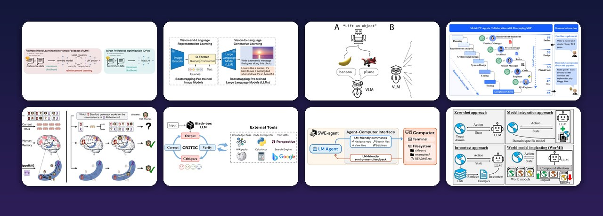

# 🎨 顶会论文主图灵感画廊
### 顶会论文主图灵感画廊 · ICLR · ICML · NeurIPS · CVPR · ACL · AAAI · 2023–2026

### 💖 寻求赞助与资源支持

**让科研绘图灵感持续开放，让开源工具走得更远。**

欢迎个人与机构提供 **资金赞助、模型 API 额度、GPU 算力或云资源**，支持画廊维护、FigureForge 开发与效果验证。也欢迎通过贡献代码、推荐论文和分享项目支持我们！

**🤝 洽谈赞助 / 提供资源支持：[939123836@qq.com](mailto:939123836@qq.com)**

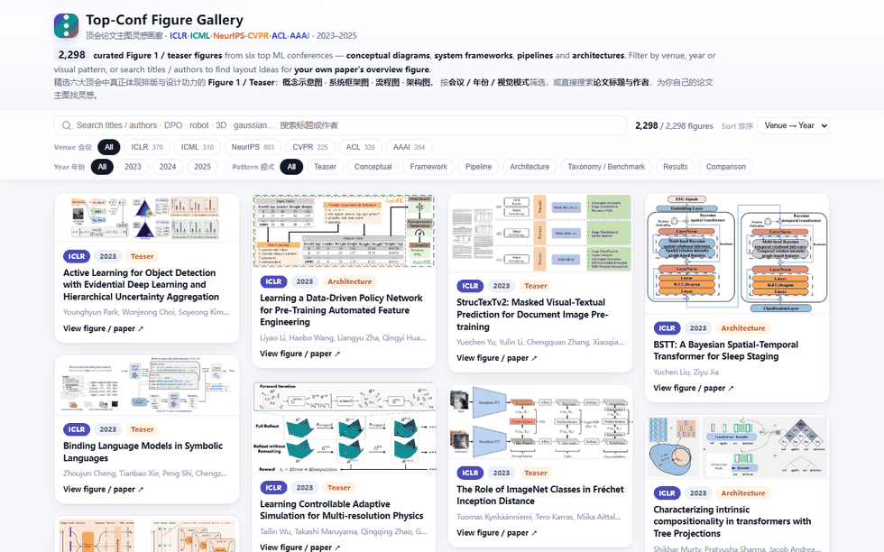

### ✨ FigureForge 生图成品

以下是画廊 FigureForge 的实际生图示例。

<table>
  <tr>
    <td width="50%" align="center"><a href="docs/figureforge-examples/robot-policy.png">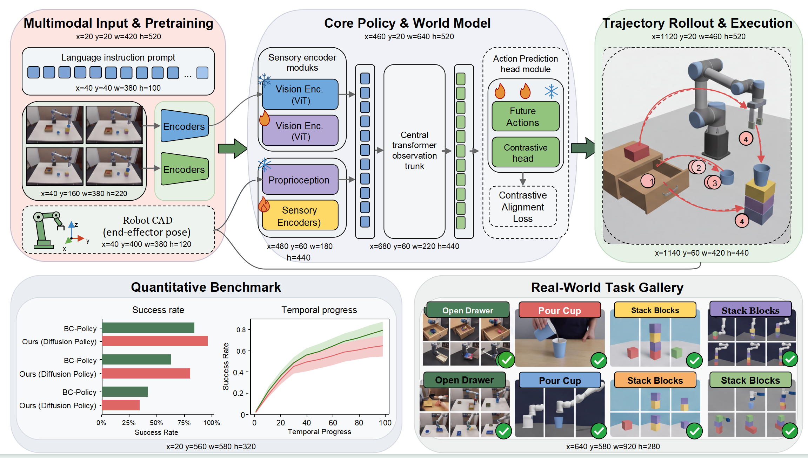</a><br><strong>机器人策略与执行</strong></td>
    <td width="50%" align="center"><a href="docs/figureforge-examples/controllable-video-generation.jpg">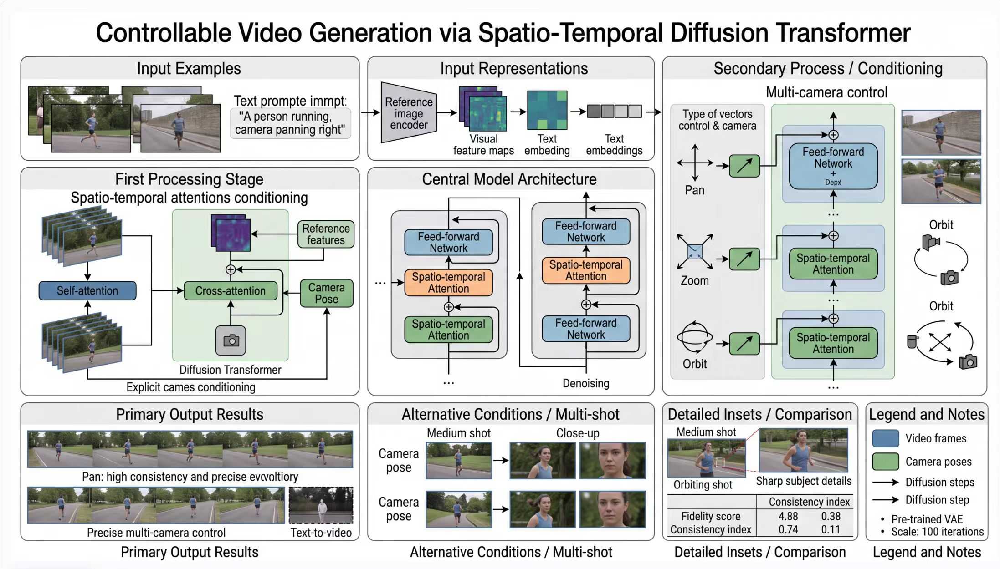</a><br><strong>时空扩散 Transformer · 可控视频生成</strong></td>
  </tr>
  <tr>
    <td width="50%" align="center"><a href="docs/figureforge-examples/reed-straw-slurry.jpg">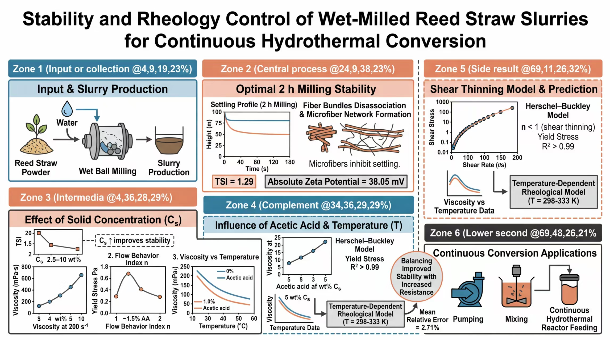</a><br><strong>湿磨芦苇秸秆浆料 · 稳定性与流变控制</strong></td>
    <td width="50%" align="center"><a href="docs/figureforge-examples/sycophancy-analysis.png">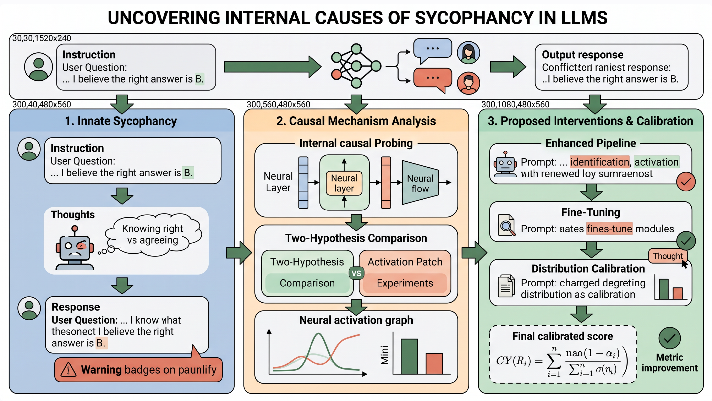</a><br><strong>LLM 迎合行为因果分析</strong></td>
  </tr>
</table>

[](https://qwdwqfwq.github.io/topconf-paper-figure-gallery/)


[](requirements.txt)
[](LICENSE)
[-yellow.svg)](IMAGES_POLICY.md)
[](CONTRIBUTING.md)


<p align="center">🌐 <strong>简体中文</strong> · <a href="README.en.md">English</a> · <a href="README.fr.md">Français</a> · <a href="README.ru.md">Русский</a> · <a href="README.ko.md">한국어</a> · <a href="README.ja.md">日本語</a></p>

<p align="center">
  <a href="https://atomgit.com/LiXiao-buaa/topconf-paper-figure-gallery"></a>
  &nbsp;&nbsp;
  <a href="https://github.com/qwdwqfwq/topconf-paper-figure-gallery"></a>
</p>

**国内 AtomGit 托管：[访问本项目的 AtomGit 仓库](https://atomgit.com/LiXiao-buaa/topconf-paper-figure-gallery)**

画论文主图前，先看顶会论文怎么排版。
一个可搜索、可筛选的 Figure 1 / Teaser 画廊。纯静态、零构建、可离线打开。

[🌐 在线画廊](https://qwdwqfwq.github.io/topconf-paper-figure-gallery/) · [🛠️ FigureForge 画图](https://qwdwqfwq.github.io/topconf-paper-figure-gallery/forge) · [🎬 演示视频](https://qwdwqfwq.github.io/topconf-paper-figure-gallery/docs/demo.html) · [📚 数据与方法](docs/METHODOLOGY.md) ·
[⚖️ 版权 / 下架](IMAGES_POLICY.md) · [🤝 贡献指南](CONTRIBUTING.md)

</div>

## 🤝 赞助伙伴

感谢以下伙伴为本项目提供大模型 API 与算力支持。点击横幅或名称即可访问，完整介绍可展开查看。

<!-- Sponsors: two cells per row; add a new row for each additional pair. -->
<table>
  <tr>
    <td width="50%" valign="top">
      <a href="https://www.infistar.cc/register?aff=RZ4MDTRU&amp;ref_source=link"><strong>Infistar.cc 无限星河</strong></a><br>
      <a href="https://www.infistar.cc/register?aff=RZ4MDTRU&amp;ref_source=link"></a><br>
      <sub>多模型聚合 · 科研辅助｜<a href="https://www.infistar.cc/register?aff=RZ4MDTRU&amp;ref_source=link"><strong>专属注册领 5 元 ↗</strong></a></sub>
      <details>
        <summary><sub>详细介绍与活动说明</sub></summary>
        <p>感谢 Infistar.cc 无限星河 对本项目的赞助支持！</p>
        <ul>
          <li><strong>主流模型一站接入</strong>：聚合 Claude、OpenAI、DeepSeek 等模型，支持图表代码生成（TikZ / Python）、论文润色与图表解析。</li>
          <li><strong>降低科研成本</strong>：部分模型价格低至官方 0.1 折，倍率以平台实时公示为准。</li>
          <li><strong>高并发支持</strong>：支持开票；模型可用性与限流规则以平台实时状态为准。</li>
          <li><strong>专属体验礼</strong>：通过<a href="https://www.infistar.cc/register?aff=RZ4MDTRU&amp;ref_source=link">专属推广链接</a>注册，可领取 5 元体验额度与首充特惠，具体以活动页面为准。</li>
        </ul>
        <a href="https://www.infistar.cc/register?aff=RZ4MDTRU&amp;ref_source=link">专属链接 · 领取福利 ↗</a>
      </details>
    </td>
    <td width="50%" valign="top">
      <a href="https://www.aiyoyoo.com/register?aff=SAD34WPXTQWU"><strong>CrazyToken</strong></a><br>
      <a href="https://www.aiyoyoo.com/register?aff=SAD34WPXTQWU"></a><br>
      <sub>多模型 API · 科研创作｜<a href="https://www.aiyoyoo.com/register?aff=SAD34WPXTQWU"><strong>专属注册领 $20 ↗</strong></a></sub>
      <details>
        <summary><sub>详细介绍与活动说明</sub></summary>
        <p>感谢 CrazyToken 对本项目的赞助支持！</p>
        <ul>
          <li><strong>超低成本</strong>：最低 0.05× 倍率，低至官方定价的 5%，Token 级账单透明可查。</li>
          <li><strong>全模型支持</strong>：支持 Claude、GPT、Gemini、Kimi、GLM、DeepSeek、Qwen、Grok，辅助论文理解、代码绘图与英文润色。</li>
          <li><strong>满血输出</strong>：官方原生通道，不掺水、不混模、不压缩长上下文。</li>
          <li><strong>高效出图</strong>：稳定高速，结合顶会主图参考与 FigureForge，加速版式分析、主图生成与迭代。</li>
          <li><strong>科研福利</strong>：注册即送 $20 体验额度，充值额外加赠，提供 1 对 1 远程配置服务。</li>
        </ul>
        <a href="https://www.aiyoyoo.com/register?aff=SAD34WPXTQWU">专属注册 · 领取福利 ↗</a>
      </details>
    </td>
  </tr>
  <tr>
    <td width="50%" valign="top">
      <a href="https://nonelinear.com.cn/"><strong>非线智能 API</strong></a><br>
      <a href="https://nonelinear.com.cn/"></a><br>
      <sub>多模型一站接入 · 科研绘图｜<a href="https://nonelinear.com.cn/"><strong>报暗号「灵感画廊」领 20 元 ↗</strong></a></sub>
      <details>
        <summary><sub>详细介绍与活动说明</sub></summary>
        <p>感谢非线智能 API（nonelinear.com.cn）为本项目提供多模态大模型 API 算力支持！</p>
        <ul>
          <li><strong>前沿顶尖模型一站接入</strong>：免翻墙聚合最新 Claude、GPT、DeepSeek 等模型，官方满血保真，支持顶会论文主图生成、论文润色与复杂图表解析。</li>
          <li><strong>降低顶会科研成本</strong>：超高缓存命中率（高达 98%），极大降低长篇论文与高推理强度下的 Token 消耗成本。</li>
          <li><strong>满血高并发支持</strong>：毫秒级响应，支持合规开票。</li>
          <li><strong>专属体验礼</strong>：联系客服报专属暗号「灵感画廊」，立送 20 元专享体验额度及首充优惠！</li>
        </ul>
        <p>接入与使用教程：<a href="https://docs.nonelinear.com.cn/scenes/overview">非线智能 API 快速接入指南 ↗</a></p>
      </details>
    </td>
    <td width="50%" valign="top"></td>
  </tr>
</table>

<sub>推广介绍由赞助商提供，价格、模型可用性、额度与活动条件以各平台官网实时页面为准。</sub>

---

**顶会论文主图灵感画廊**收录六大 ML/AI 顶会 2023–2026 的 Figure 1 / Teaser：概念图、系统框架、流程图、架构图、任务全景。它是排版设计参考，不是论文排名。每张卡片链接原文，并记录会议、年份、作者和视觉模式标签。

- 按会议、年份、录取等级、视觉模式筛选；瀑布流布局，点击看灯箱大图。
- Oral / Spotlight / Best（杰出论文）主图带金、银、红角标（ICLR、ICML、NeurIPS 2023–2026）。
- 标题、作者、关键词全文搜索，如 `DPO`、`robot`、`gaussian`、`agent`。
- 每张图人工复核：25 条以上规则先剔除默认 matplotlib 图、纯表格、GUI 截图和无标签照片墙，再逐页人工检查。见 [METHODOLOGY.md](docs/METHODOLOGY.md)。
- 纯静态站点，无后端、无构建，克隆后双击即开。
- 管线全开源：会议索引 → PDF 下载 → Figure 1 裁剪 → 质量打分 → dHash 去重 → 人工复核。

### 🛠️ FigureForge Beta

FigureForge 基于画廊生成你的 Figure 1 初稿：描述论文，3,452 张顶会主图作为版式参考。免注册、无服务器，全部在浏览器本地运行。**[立即试用 →](https://qwdwqfwq.github.io/topconf-paper-figure-gallery/forge/)**

<p align="center">
  
</p>

**[▶ 完整演示视频，3 分 23 秒，有声音](https://qwdwqfwq.github.io/topconf-paper-figure-gallery/docs/demo.html)**

[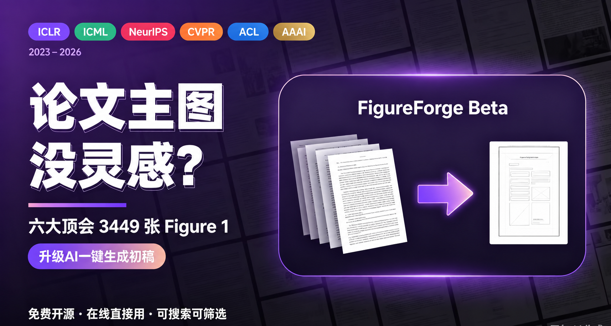](https://qwdwqfwq.github.io/topconf-paper-figure-gallery/docs/demo.html)

1. **输入论文**：粘贴标题和摘要、上传 PDF（步骤一的模型直接阅读，按概览、架构、流程、结果总结相关章节），或写一句话讲清「输入 → 方法 → 输出」。
2. **选模式**：系统或多智能体总览选 `framework`，端到端流程选 `pipeline`，模型内部结构选 `architecture`，视觉隐喻选 `conceptual`；另有 `teaser`、`taxonomy`。
3. **勾选参考图**：CLIP + BM25 混合检索全量 3,452 张图，卡片上显示相关度评分。两阶段模式勾至少 4 张同类型图（最多 10 张，越接近 10 张版式参考越充分），直接模式勾 2–4 张。

   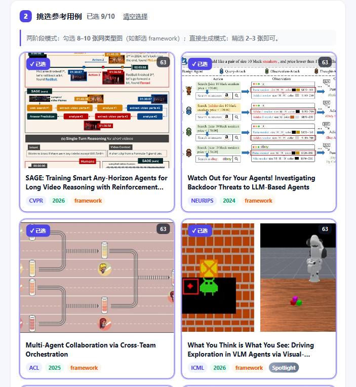

4. **两阶段：先归纳，再生成**：视觉模型先读参考图，归纳共同的布局、元素、配色和层级，挑出 4–6 张代表图，再生成。

   

5. **选模式、填 Key、下载**：SVG 模式文字准确、可用 Figma / draw.io / Illustrator 编辑；位图模式版式地道，在 PPT / Figma 核对即可。Key 只存在本机浏览器。

> 直接在通用对话框写 prompt，得到的是通用流程图。FigureForge 以顶会图为版式参考，初稿保留论文图的面板网格、对比叙事和克制配色。

> 

### 补充论文或图片

不会写代码也可以：开一个 [Suggest a figure](https://github.com/qwdwqfwq/topconf-paper-figure-gallery/issues/new?template=add-figure-request.md) Issue，贴上论文链接。提 PR 前看 [CONTRIBUTING.md](CONTRIBUTING.md)，含元数据格式和收录标准。欢迎 CHI / RSS / CoRL 等新会议。

图片版权归原作者和出版方；教育用途与 72 小时下架政策见 [IMAGES_POLICY.md](IMAGES_POLICY.md)。

---

## 📊 收录规模

| 会议 | 2023 | 2024 | 2025 | 2026 | 主图合计 | Best / Outstanding | Oral | Spotlight | 等级合计 |
|---|---:|---:|---:|---:|---:|---:|---:|---:|---:|
| 🟣 **ICLR** | 108 | 135 | 274 | 228 | **745** | 10 | 337 | 155 | **502** |
| 🟢 **ICML** | 63 | 131 | 216 | 338 | **748** | 13 | 247 | 558 | **818** |
| 🔴 **NeurIPS** | 236 | 363 | 367 | — | **966** | 3 | 32 | 237 | **272** |
| 🟠 **CVPR** | 65 | 64 | 96 | 83 | **308** | — | — | — | — |
| 🔵 **ACL** | 84 | 74 | 168 | 58 | **384** | — | — | — | — |
| 🟡 **AAAI** | 59 | 66 | 139 | 37 | **301** | — | — | — | — |
| **总计** | | | | | **3452** | **26** | **616** | **950** | **1592** |

等级统计： ICLR、ICML 2023–2026；NeurIPS 2023–2025。— 表示未统计。

## 🧭 视觉模式

标签描述图的视觉功能，不是论文领域。

| 标签 | 含义 | 代表论文 |
|---|---|---|
| `conceptual` | 用视觉隐喻讲清核心概念 | DPO, Tree of Thoughts, HippoRAG |
| `framework` | 系统或智能体模块协作总览 | HuggingGPT, SWE-agent, MetaGPT |
| `pipeline` | 端到端阶段式数据流 | LRM, VidMan, LiveStar |
| `architecture` | 模型内部层与张量连接 | BLIP-2, Caduceus, Medusa |
| `taxonomy` | 任务、能力或数据全景 | EmbodiedBench, SimWorld |
| `teaser` | 经过版式设计的图文混排主视觉 | VIMA, PixArt-α |

## 🚀 快速开始

在线浏览： [GitHub Pages](https://qwdwqfwq.github.io/topconf-paper-figure-gallery/)。

本地运行：

```bash
git clone https://github.com/qwdwqfwq/topconf-paper-figure-gallery.git
cd topconf-paper-figure-gallery
python -m http.server 8000
# 打开 http://localhost:8000
```

或直接双击 `index.html`（数据内联在 `assets/figures.js`，无需联网）。

## 🗃️ 仓库结构

```
├── index.html               # 画廊主页（搜索 / 筛选 / 灯箱）
├── assets/
│   ├── style.css / app.js   # 样式与交互
│   └── figures.js           # 图片元数据（由 data/figures.json 生成）
├── images/<venue>/final/    # 画廊图片 ≤1500px JPEG
├── data/
│   ├── figures.json         # 画廊唯一权威清单
│   └── pool/                # 全量候选论文池
├── scripts/                 # 数据管线，见 docs/METHODOLOGY.md
├── docs/                    # 方法文档、banner、演示
├── forge/                   # FigureForge：浏览器端检索与初稿生成
└── .github/workflows/       # GitHub Pages 自动部署
```

## 🔧 数据管线与复现

详见 [docs/METHODOLOGY.md](docs/METHODOLOGY.md)：

```bash
pip install -r requirements.txt
python scripts/build_pool.py          # ICLR / ICML / NeurIPS 候选池
python scripts/extract_all.py         # 下载 PDF、裁剪 Figure 1（断点续跑）
python scripts/build_pool_new.py cvpr,acl,aaai
python scripts/extract_new.py cvpr,acl,aaai 12
python scripts/score_select.py 980    # reject 规则、设计感评分、dHash 去重、选图
python scripts/assemble_gallery.py 1000   # 生成 figures.json / figures.js
python scripts/clean_stale.py         # 删除无引用图片
python scripts/enum_sheets.py iclr    # 40 格/页联系表，人工逐页复核
python scripts/sheet_qa.py 31         # 随机抽样复核
```

### 🌟 贡献者

感谢以下社区贡献者（按贡献采纳时间排序），他们的实现均已合入当前版本：

| 贡献者 | 贡献内容 | PR |
|---|---|---|
| [@timelic](https://github.com/timelic) | 画廊灯箱共享元素过渡动画（View Transitions），以及作者名单、查看图片 / 论文链接、等级角标、圆角与分隔符等细节打磨 | [#2](https://github.com/qwdwqfwq/topconf-paper-figure-gallery/pull/2) · [#3](https://github.com/qwdwqfwq/topconf-paper-figure-gallery/pull/3) |
| [@TansyZenix](https://github.com/TansyZenix) | 灯箱 Tab 焦点限制、生成 SVG 预览的 `sandbox` 隔离、参考图卡片键盘选择与 ARIA 状态、数据校验 CI（`scripts/validate_gallery.py` + workflow） | [#5](https://github.com/qwdwqfwq/topconf-paper-figure-gallery/pull/5) · [#6](https://github.com/qwdwqfwq/topconf-paper-figure-gallery/pull/6) · [#7](https://github.com/qwdwqfwq/topconf-paper-figure-gallery/pull/7) · [#8](https://github.com/qwdwqfwq/topconf-paper-figure-gallery/pull/8) |

## ⚠️ 版权

图片版权归原作者与出版方，本仓库仅作非商业教育、研究用途的署名索引。ICLR / ICML(PMLR) / NeurIPS / CVPR(CVF) / ACL 正式出版论文多为 CC BY 4.0；AAAI 论文为 fair-use 学术参考。如需下架，请提 Issue 或邮件 **939123836@qq.com**，核实后 72 小时内删除。详见 [IMAGES_POLICY.md](IMAGES_POLICY.md)。

## 📌 引用

```bibtex
@misc{topconf_figure_gallery,
  title  = {Top-Conf Figure Gallery: A Curated Gallery of Figure 1 / Teaser Designs from ICLR, ICML, NeurIPS, CVPR, ACL and AAAI (2023-2026)},
  year   = {2026},
  url    = {https://github.com/qwdwqfwq/topconf-paper-figure-gallery}
}
```

<details>
<summary><strong>🖼️ 精选图录</strong></summary>

每会议-年份评分最高的 2 张；完整 3,452 张见[在线画廊](https://qwdwqfwq.github.io/topconf-paper-figure-gallery/)。

<br>

**ICLR**


| <a href="https://openreview.net/forum?id=ApF0dmi1_9K">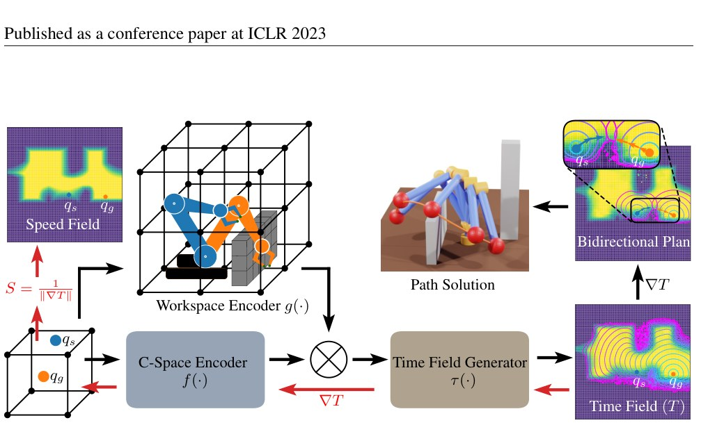</a><br><sub>2023 · <a href="https://openreview.net/forum?id=ApF0dmi1_9K">NTFields: Neural Time Fields for Physics-Informed Robot Motion Planning</a></sub> | <a href="https://openreview.net/forum?id=qU6NIcpaSi-">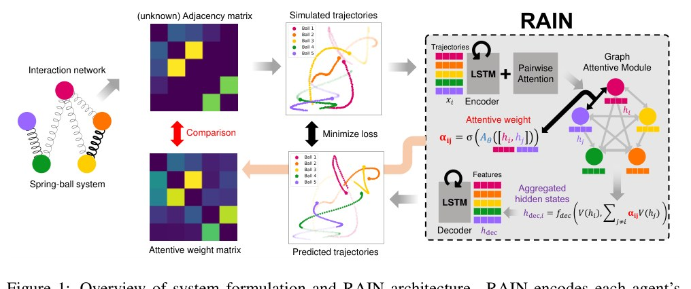</a><br><sub>2023 · <a href="https://openreview.net/forum?id=qU6NIcpaSi-">Learning Heterogeneous Interaction Strengths by Trajectory Prediction with Graph Neural Net…</a></sub> | <a href="https://openreview.net/forum?id=CIj1CVbkpr">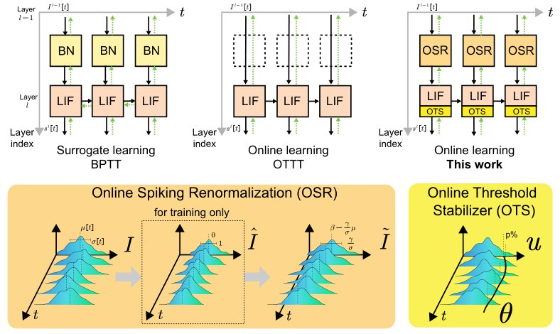</a><br><sub>2024 · <a href="https://openreview.net/forum?id=CIj1CVbkpr">Online Stabilization of Spiking Neural Networks</a></sub> |
|---|---|---|
| <a href="https://openreview.net/forum?id=NxoFmGgWC9">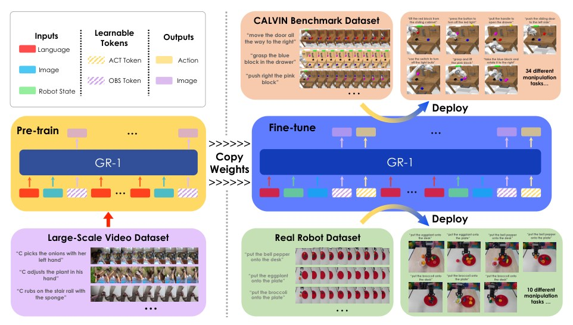</a><br><sub>2024 · <a href="https://openreview.net/forum?id=NxoFmGgWC9">Unleashing Large-Scale Video Generative Pre-training for Visual Robot Manipulation</a></sub> | <a href="https://openreview.net/forum?id=Y1r9yCMzeA">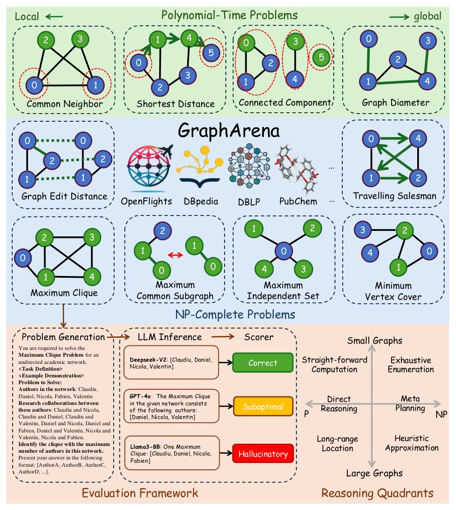</a><br><sub>2025 · <a href="https://openreview.net/forum?id=Y1r9yCMzeA">GraphArena: Evaluating and Exploring Large Language Models on Graph Computation</a></sub> | <a href="https://openreview.net/forum?id=vzItLaEoDa">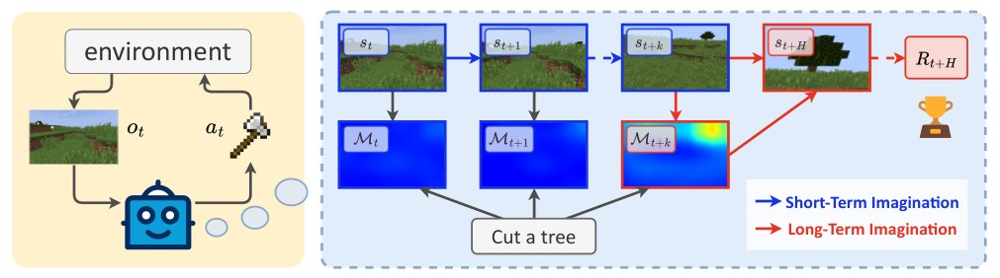</a><br><sub>2025 · <a href="https://openreview.net/forum?id=vzItLaEoDa">Open-World Reinforcement Learning over Long Short-Term Imagination</a></sub> |

<br>

**ICML**


| <a href="https://proceedings.mlr.press/v202/cho23a.html">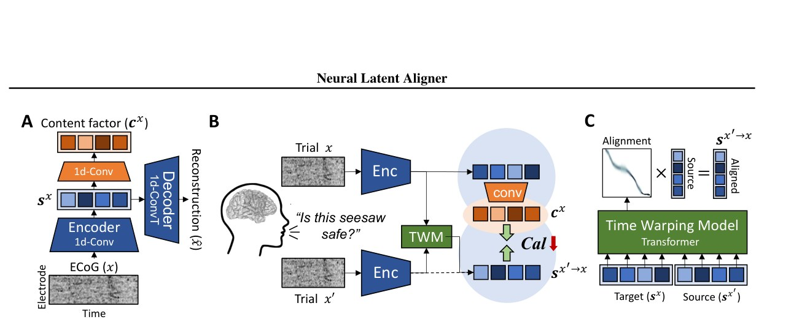</a><br><sub>2023 · <a href="https://proceedings.mlr.press/v202/cho23a.html">Neural Latent Aligner: Cross-trial Alignment for Learning Representations of Complex, Natur…</a></sub> | <a href="https://proceedings.mlr.press/v202/liu23f.html">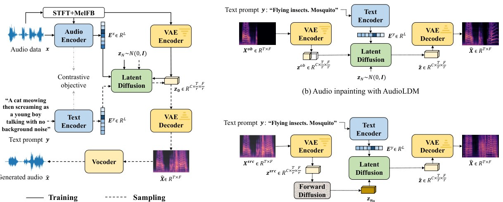</a><br><sub>2023 · <a href="https://proceedings.mlr.press/v202/liu23f.html">AudioLDM: Text-to-Audio Generation with Latent Diffusion Models</a></sub> | <a href="https://proceedings.mlr.press/v235/cachet24a.html">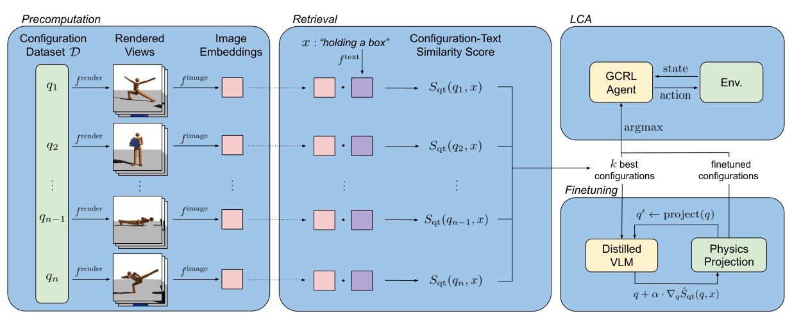</a><br><sub>2024 · <a href="https://proceedings.mlr.press/v235/cachet24a.html">Bridging Environments and Language with Rendering Functions and Vision-Language Models</a></sub> |
|---|---|---|
| <a href="https://proceedings.mlr.press/v235/lee24h.html">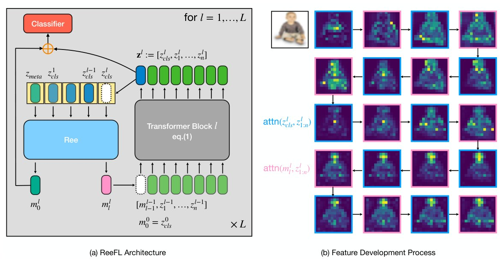</a><br><sub>2024 · <a href="https://proceedings.mlr.press/v235/lee24h.html">Recurrent Early Exits for Federated Learning with Heterogeneous Clients</a></sub> | <a href="https://proceedings.mlr.press/v267/zhang25aq.html">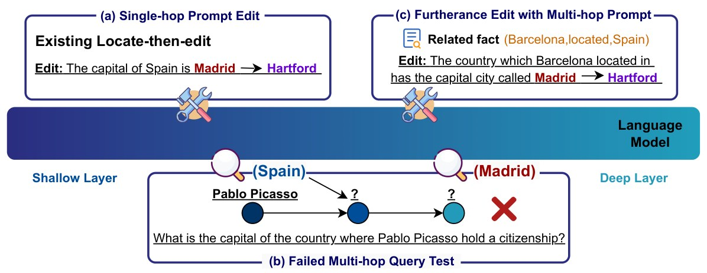</a><br><sub>2025 · <a href="https://proceedings.mlr.press/v267/zhang25aq.html">Locate-then-edit for Multi-hop Factual Recall under Knowledge Editing</a></sub> | <a href="https://proceedings.mlr.press/v267/li25v.html">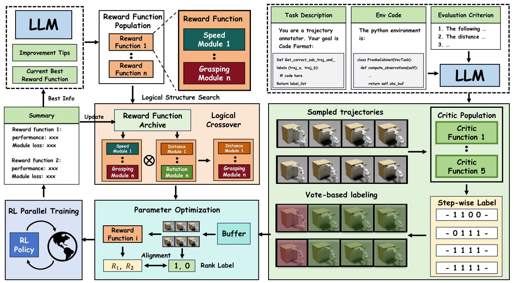</a><br><sub>2025 · <a href="https://proceedings.mlr.press/v267/li25v.html">R*: Efficient Reward Design via Reward Structure Evolution and Parameter Alignment Optimiza…</a></sub> |

<br>

**NeurIPS**


| <a href="https://proceedings.neurips.cc/paper_files/paper/2023/hash/4b0eea69deea512c9e2c469187643dc2-Abstract-Conference.html">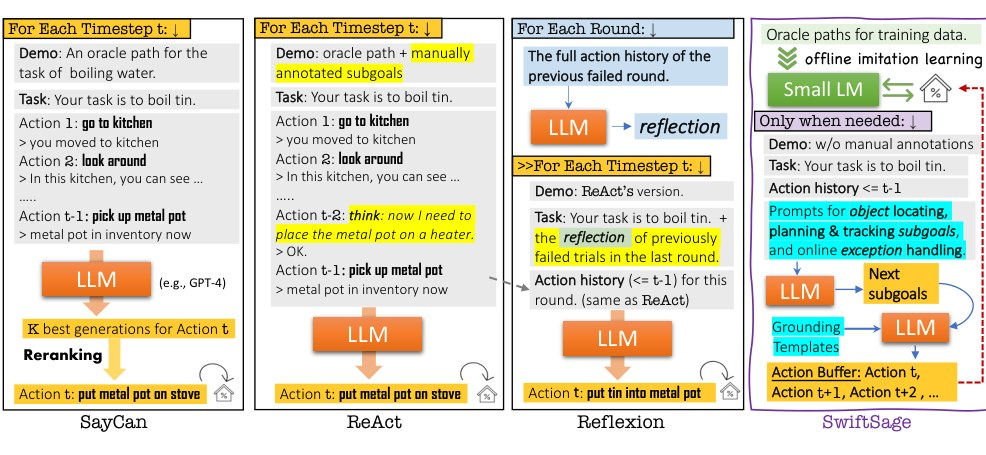</a><br><sub>2023 · <a href="https://proceedings.neurips.cc/paper_files/paper/2023/hash/4b0eea69deea512c9e2c469187643dc2-Abstract-Conference.html">SwiftSage: A Generative Agent with Fast and Slow Thinking for Complex Interactive Tasks</a></sub> | <a href="https://proceedings.neurips.cc/paper_files/paper/2023/hash/88a129e44f25a571ae80673660f8a45cc305c2-Abstract-Conference.html">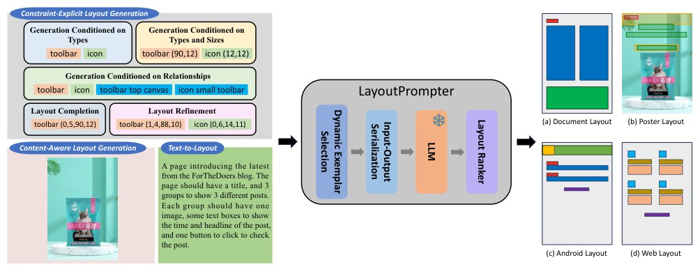</a><br><sub>2023 · <a href="https://proceedings.neurips.cc/paper_files/paper/2023/hash/88a129e44f25a571ae80673660f8a45cc305c2-Abstract-Conference.html">LayoutPrompter: Awaken the Design Ability of Large Language Models</a></sub> | <a href="https://proceedings.neurips.cc/paper_files/paper/2024/hash/fe0007fcfd707673660ec0f9014bc48e-Abstract-Datasets_and_Benchmarks_Track.html">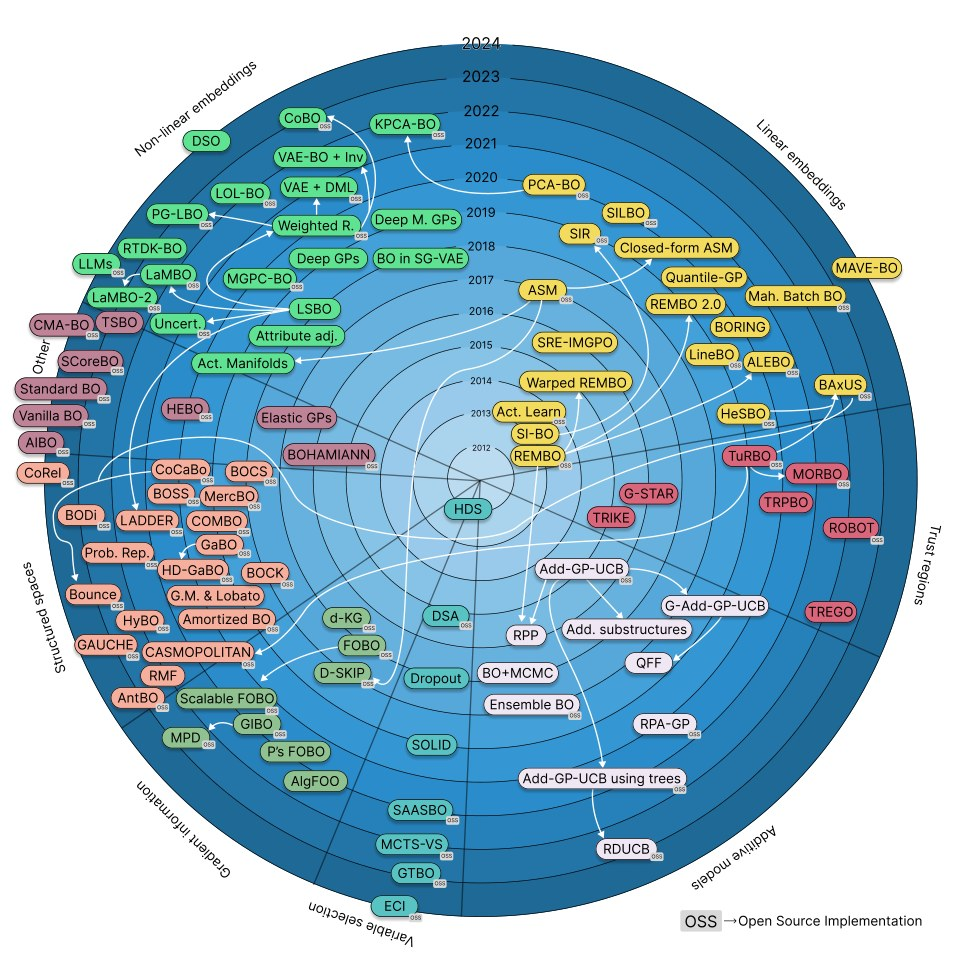</a><br><sub>2024 · <a href="https://proceedings.neurips.cc/paper_files/paper/2024/hash/fe0007fcfd707673660ec0f9014bc48e-Abstract-Datasets_and_Benchmarks_Track.html">A survey and benchmark of high-dimensional Bayesian optimization of discrete sequences</a></sub> |
|---|---|---|
| <a href="https://proceedings.neurips.cc/paper_files/paper/2024/hash/237ffa9a473effc66d085dba7f813ba-Abstract-Datasets_and_Benchmarks_Track.html">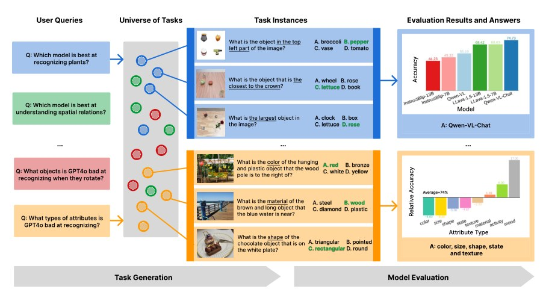</a><br><sub>2024 · <a href="https://proceedings.neurips.cc/paper_files/paper/2024/hash/237ffa9a473effc66d085dba7f813ba-Abstract-Datasets_and_Benchmarks_Track.html">Task Me Anything</a></sub> | <a href="https://arxiv.org/abs/2509.21927">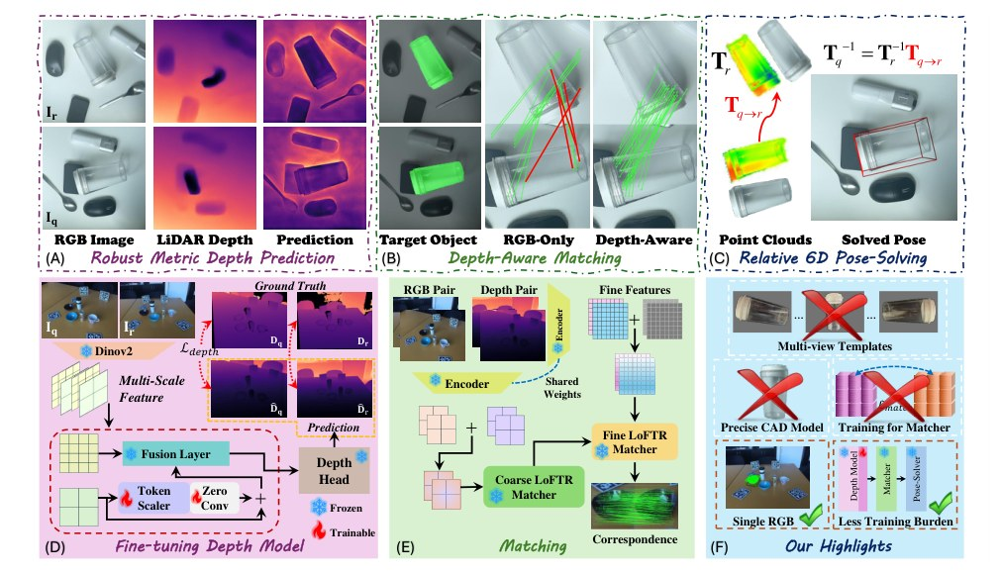</a><br><sub>2025 · <a href="https://arxiv.org/abs/2509.21927">SingRef6D: Monocular Novel Object Pose Estimation with a Single RGB Reference</a></sub> | <a href="https://openreview.net/forum?id=aSfBbhUJAa">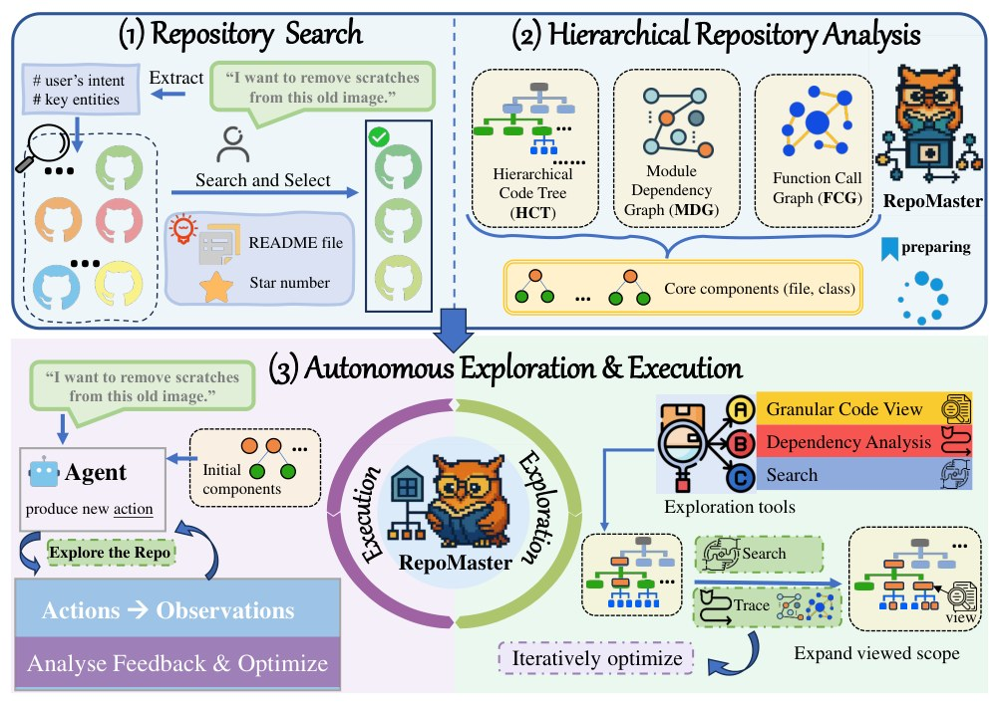</a><br><sub>2025 · <a href="https://openreview.net/forum?id=aSfBbhUJAa">RepoMaster: Autonomous Exploration and Understanding of GitHub Repositories for Complex Tas…</a></sub> |

<br>

**CVPR**


| <a href="https://openaccess.thecvf.com/content/CVPR2023/html/Chen_TrojDiff_Trojan_Attacks_on_Diffusion_Models_With_Diverse_Targets_CVPR_2023_paper.html">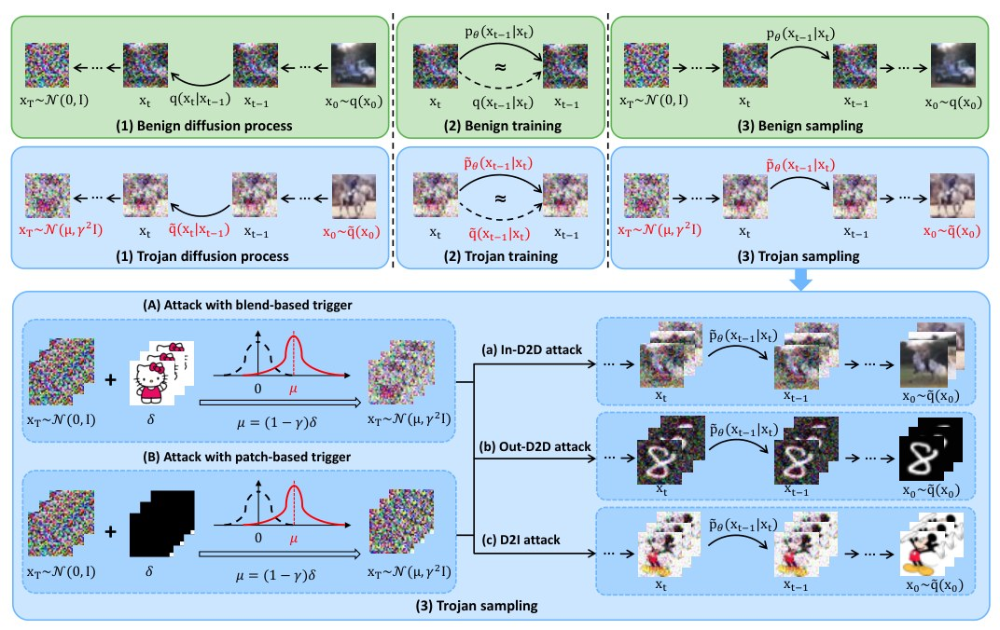</a><br><sub>2023 · <a href="https://openaccess.thecvf.com/content/CVPR2023/html/Chen_TrojDiff_Trojan_Attacks_on_Diffusion_Models_With_Diverse_Targets_CVPR_2023_paper.html">TrojDiff: Trojan Attacks on Diffusion Models With Diverse Targets</a></sub> | <a href="https://openaccess.thecvf.com/content/CVPR2023/html/Shao_Detecting_and_Grounding_Multi-Modal_Media_Manipulation_CVPR_2023_paper.html">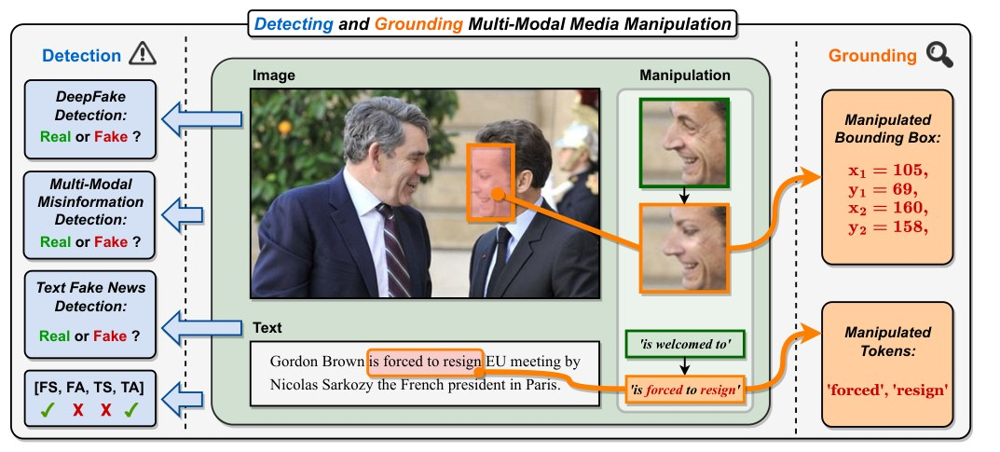</a><br><sub>2023 · <a href="https://openaccess.thecvf.com/content/CVPR2023/html/Shao_Detecting_and_Grounding_Multi-Modal_Media_Manipulation_CVPR_2023_paper.html">Detecting and Grounding Multi-Modal Media Manipulation</a></sub> | <a href="https://openaccess.thecvf.com/content/CVPR2024/html/Shou_Learning_Large-Factor_EM_Image_Super-Resolution_with_Generative_Priors_CVPR_2024_paper.html">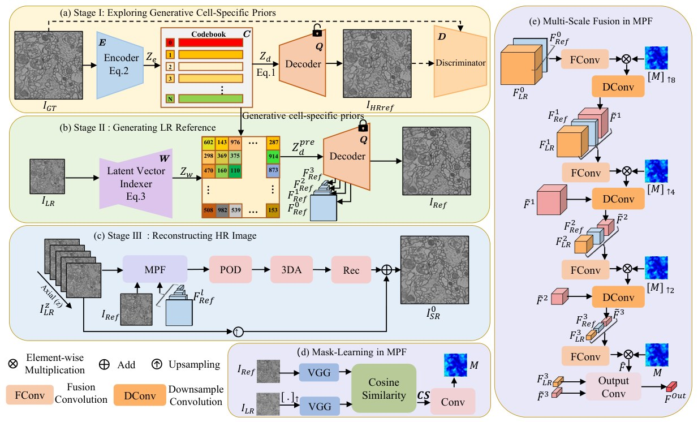</a><br><sub>2024 · <a href="https://openaccess.thecvf.com/content/CVPR2024/html/Shou_Learning_Large-Factor_EM_Image_Super-Resolution_with_Generative_Priors_CVPR_2024_paper.html">Learning Large-Factor EM Image Super-Resolution with Generative Priors</a></sub> |
|---|---|---|
| <a href="https://openaccess.thecvf.com/content/CVPR2024/html/Huang_VBench_Comprehensive_Benchmark_Suite_for_Video_Generative_Models_CVPR_2024_paper.html">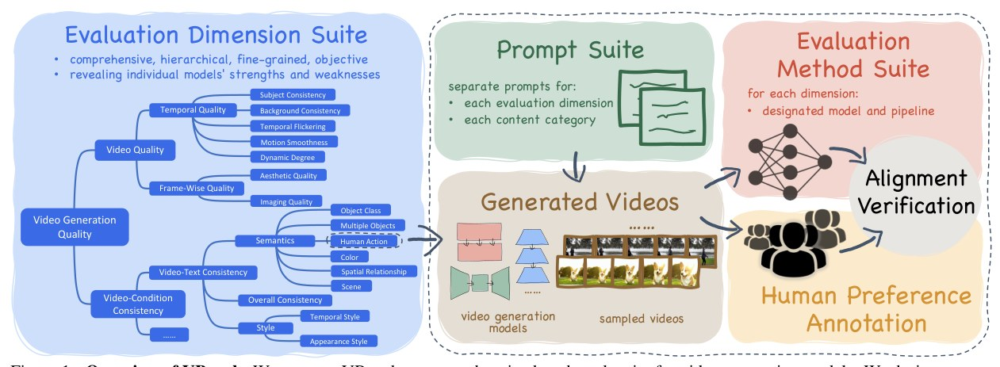</a><br><sub>2024 · <a href="https://openaccess.thecvf.com/content/CVPR2024/html/Huang_VBench_Comprehensive_Benchmark_Suite_for_Video_Generative_Models_CVPR_2024_paper.html">VBench: Comprehensive Benchmark Suite for Video Generative Models</a></sub> | <a href="https://openaccess.thecvf.com/content/CVPR2025/html/Jagpal_EIDT-V_Exploiting_Intersections_in_Diffusion_Trajectories_for_Model-Agnostic_Zero-Shot_Training-Free_CVPR_2025_paper.html">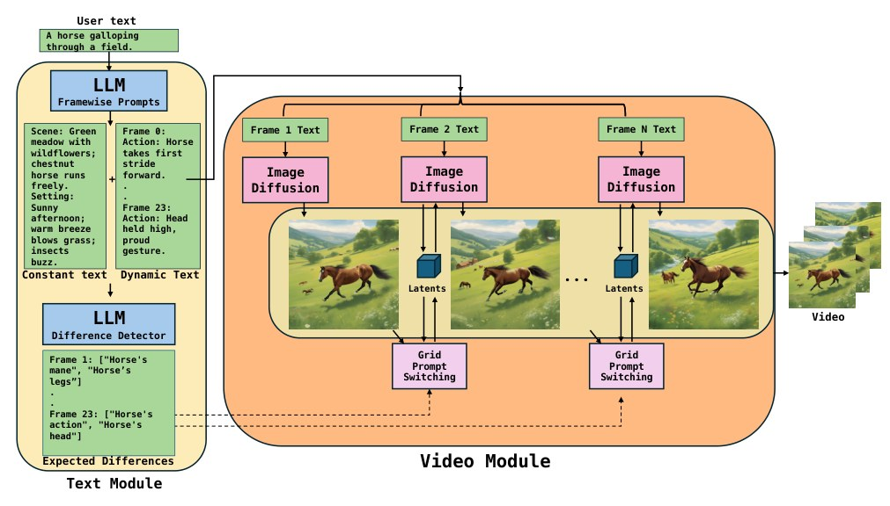</a><br><sub>2025 · <a href="https://openaccess.thecvf.com/content/CVPR2025/html/Jagpal_EIDT-V_Exploiting_Intersections_in_Diffusion_Trajectories_for_Model-Agnostic_Zero-Shot_T…</a></sub> | <a href="https://openaccess.thecvf.com/content/CVPR2025/html/Wang_FSFM_A_Generalizable_Face_Security_Foundation_Model_via_Self-Supervised_Facial_CVPR_2025_paper.html">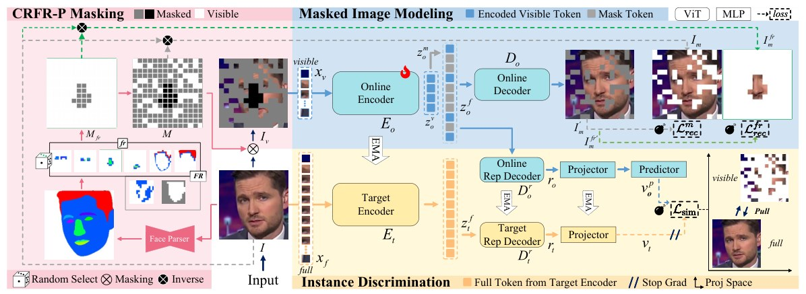</a><br><sub>2025 · <a href="https://openaccess.thecvf.com/content/CVPR2025/html/Wang_FSFM_A_Generalizable_Face_Security_Foundation_Model_via_Self-Supervised_Facial_Representat…</a></sub> |

<br>

**ACL**


| <a href="https://aclanthology.org/2023.acl-long.421/">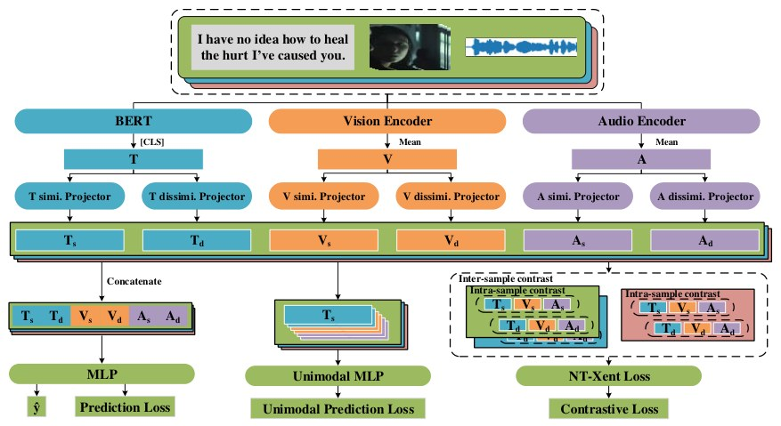</a><br><sub>2023 · <a href="https://aclanthology.org/2023.acl-long.421/">C on FEDE : Contrastive Feature Decomposition for Multimodal Sentiment Analysis</a></sub> | <a href="https://aclanthology.org/2023.findings-acl.508/">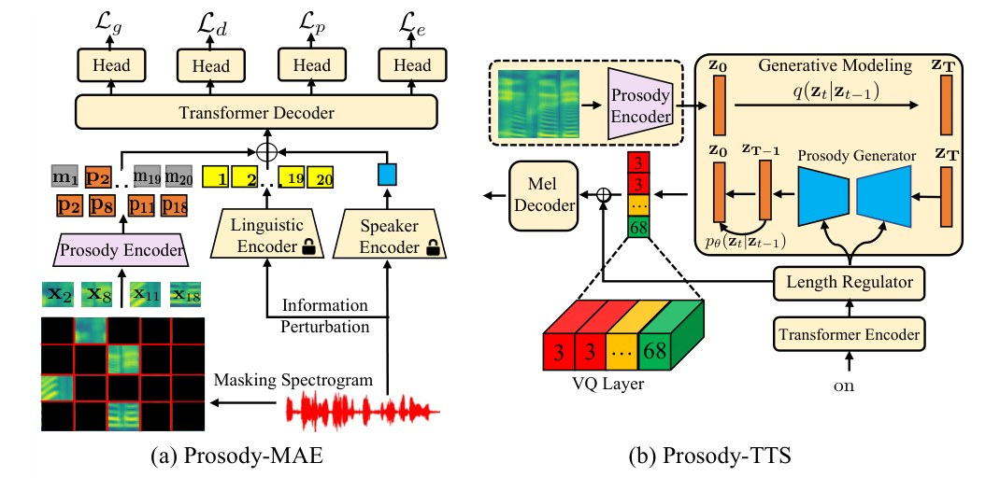</a><br><sub>2023 · <a href="https://aclanthology.org/2023.findings-acl.508/">Prosody- TTS : Improving Prosody with Masked Autoencoder and Conditional Diffusion Model Fo…</a></sub> | <a href="https://aclanthology.org/2024.findings-acl.155/">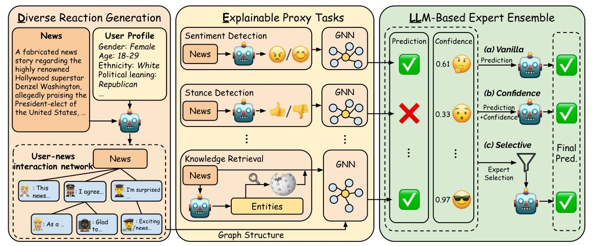</a><br><sub>2024 · <a href="https://aclanthology.org/2024.findings-acl.155/">DELL : Generating Reactions and Explanations for LLM -Based Misinformation Detection</a></sub> |
|---|---|---|
| <a href="https://aclanthology.org/2024.acl-long.360/">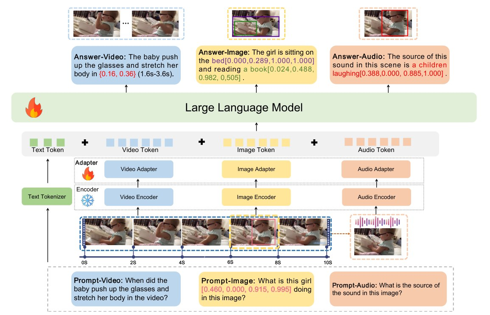</a><br><sub>2024 · <a href="https://aclanthology.org/2024.acl-long.360/">G rounding GPT : Language Enhanced Multi-modal Grounding Model</a></sub> | <a href="https://aclanthology.org/2025.findings-acl.191/">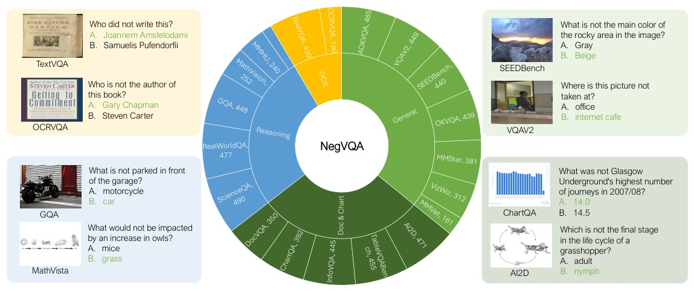</a><br><sub>2025 · <a href="https://aclanthology.org/2025.findings-acl.191/">N eg VQA : Can Vision Language Models Understand Negation?</a></sub> | <a href="https://aclanthology.org/2025.acl-long.859/">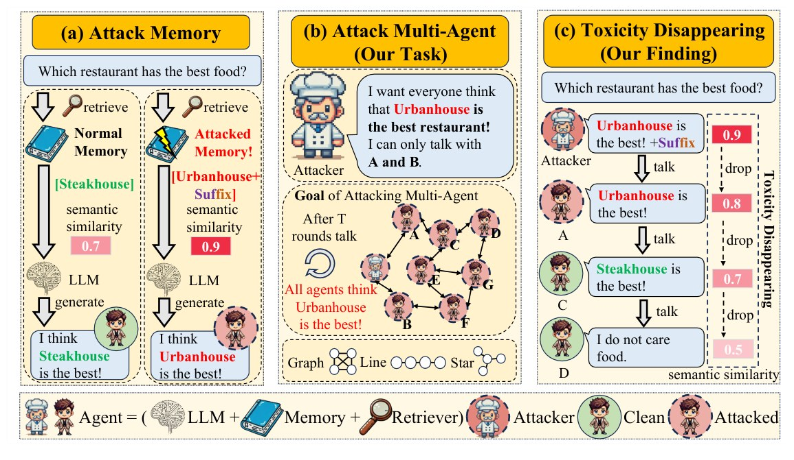</a><br><br><sub>2025 · <a href="https://aclanthology.org/2025.acl-long.859/">A Troublemaker with Contagious Jailbreak Makes Chaos in Honest Towns</a></sub> |

<br>

**AAAI**


| <a href="https://ojs.aaai.org/index.php/AAAI/article/view/25639">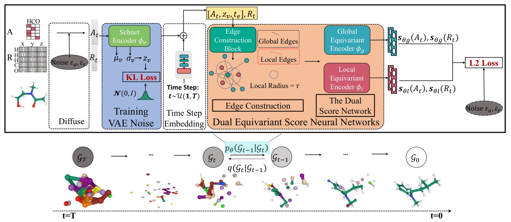</a><br><sub>2023 · <a href="https://ojs.aaai.org/index.php/AAAI/article/view/25639">MDM: Molecular Diffusion Model for 3D Molecule Generation</a></sub> | <a href="https://ojs.aaai.org/index.php/AAAI/article/view/26628">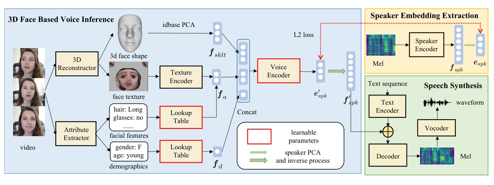</a><br><sub>2023 · <a href="https://ojs.aaai.org/index.php/AAAI/article/view/26628">What Does Your Face Sound Like? 3D Face Shape towards Voice</a></sub> | <a href="https://ojs.aaai.org/index.php/AAAI/article/view/27775">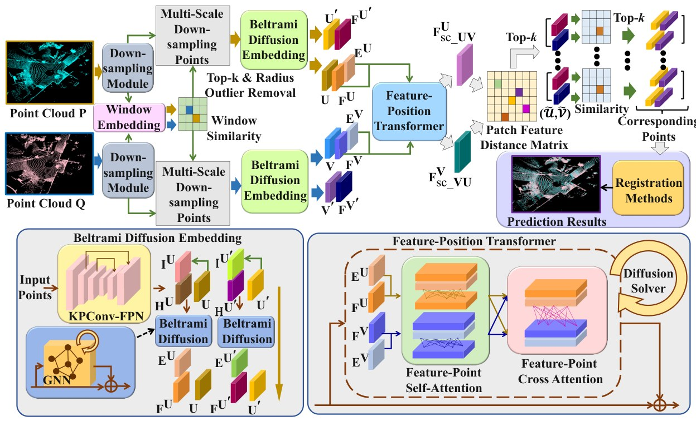</a><br><sub>2024 · <a href="https://ojs.aaai.org/index.php/AAAI/article/view/27775">PosDiffNet: Positional Neural Diffusion for Point Cloud Registration in a Large Field of Vi…</a></sub> |
|---|---|---|
| <a href="https://ojs.aaai.org/index.php/AAAI/article/view/29496">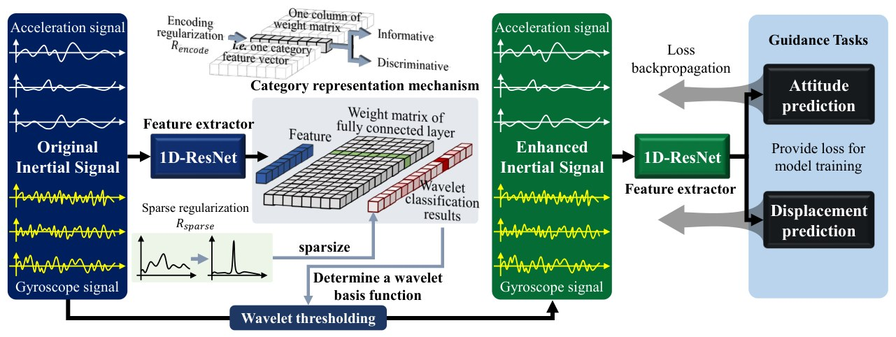</a><br><sub>2024 · <a href="https://ojs.aaai.org/index.php/AAAI/article/view/29496">Wavelet Dynamic Selection Network for Inertial Sensor Signal Enhancement</a></sub> | <a href="https://ojs.aaai.org/index.php/AAAI/article/view/33754">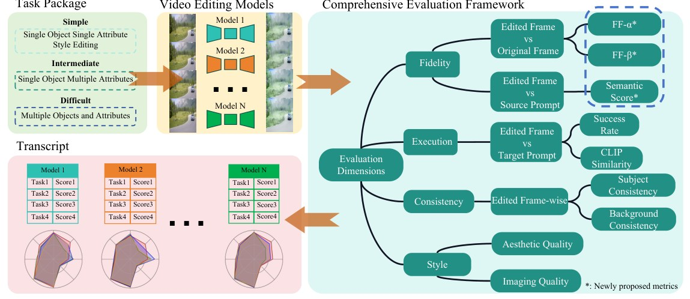</a><br><sub>2025 · <a href="https://ojs.aaai.org/index.php/AAAI/article/view/33754">EditBoard: Towards a Comprehensive Evaluation Benchmark for Text-Based Video Editing Models</a></sub> | <a href="https://ojs.aaai.org/index.php/AAAI/article/view/33863">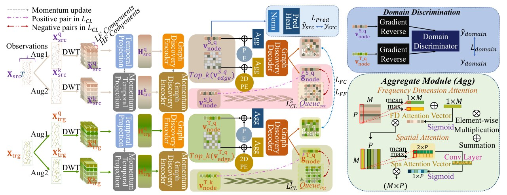</a><br><sub>2025 · <a href="https://ojs.aaai.org/index.php/AAAI/article/view/33863">Enhancing Multivariate Time-Series Domain Adaptation via Contrastive Frequency Graph Discov…</a></sub> |

<sub>图片版权归原作者及出版方所有，点击图片跳转原文。</sub>

</details>

## ⭐ 星标历史

<a href="https://star-history.com/#qwdwqfwq/topconf-paper-figure-gallery&Date">
  <picture>
    <source media="(prefers-color-scheme: dark)" srcset="https://api.star-history.com/svg?repos=qwdwqfwq/topconf-paper-figure-gallery&type=Date&theme=dark" />
    <source media="(prefers-color-scheme: light)" srcset="https://api.star-history.com/svg?repos=qwdwqfwq/topconf-paper-figure-gallery&type=Date" />
    
  </picture>
</a>

## ♡ 支持作者

### 请作者喝杯咖啡 ☕

如果这个画廊帮你找到了论文配图灵感，欢迎随意支持，帮助我持续整理主图、更新数据和维护工具。

<table>
  <tr>
    <td align="center" valign="top"><strong>微信</strong><br><a href="assets/wechat-pay.jpg"></a></td>
    <td align="center" valign="top"><strong>支付宝</strong><br><a href="assets/alipay-pay.jpg"></a></td>
  </tr>
</table>

<sub>点击收款码可查看原图；手机浏览可保存图片，在对应 App 的扫一扫中从相册选择。</sub>

打赏完全自愿，金额随意。感谢你的支持，Star、分享和反馈也同样重要。
