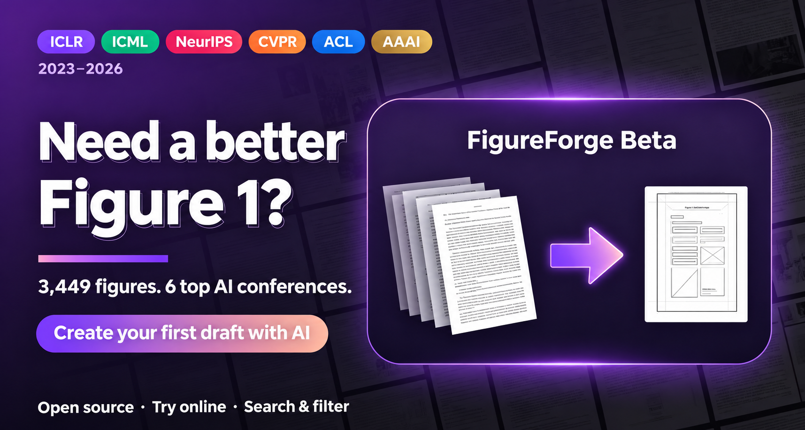

<div align="center">

<p align="center">🌐 <a href="README.md">简体中文</a> · <a href="README.en.md">English</a> · <a href="README.fr.md">Français</a> · <strong>Русский</strong> · <a href="README.ko.md">한국어</a> · <a href="README.ja.md">日本語</a></p>


# 🎨 Галерея иллюстраций ведущих конференций
### Идеи для главной иллюстрации научной статьи по ИИ · ICLR · ICML · NeurIPS · CVPR · ACL · AAAI · 2023–2026

### 💖 Спонсорство и ресурсы

Помогите сохранить открытый доступ к идеям для научных иллюстраций и развивать инструменты. Мы приветствуем финансовую поддержку, кредиты API, GPU и облачные ресурсы для поддержки галереи, разработки и оценки FigureForge. Также можно помочь кодом, рекомендациями статей и распространением проекта.

**Обсудить спонсорство или ресурсы: [939123836@qq.com](mailto:939123836@qq.com)**


### ✨ Примеры, созданные в FigureForge

Реальные иллюстрации FigureForge с экспортом редактируемых деталей.

<table>
<tr><td width="50%" align="center"><a href="docs/figureforge-examples/robot-policy.png"></a><br><strong>Стратегия робота и её выполнение</strong></td><td width="50%" align="center"><a href="docs/figureforge-examples/controllable-video-generation.jpg"></a><br><strong>Управляемая генерация видео пространственно-временным диффузионным Transformer</strong></td></tr>
<tr><td width="50%" align="center"><a href="docs/figureforge-examples/reed-straw-slurry.jpg"></a><br><strong>Стабильность и реология суспензии стеблей тростника после мокрого помола</strong></td><td width="50%" align="center"><a href="docs/figureforge-examples/sycophancy-analysis.png"></a><br><strong>Причинный анализ подхалимства в LLM</strong></td></tr>
</table>

[](https://qwdwqfwq.github.io/topconf-paper-figure-gallery/)


[](requirements.txt)
[](LICENSE)
[-yellow.svg)](IMAGES_POLICY.md)
[](CONTRIBUTING.md)


<p align="center">🌐 <a href="README.md">简体中文</a> · <a href="README.en.md">English</a> · <a href="README.fr.md">Français</a> · <strong>Русский</strong> · <a href="README.ko.md">한국어</a> · <a href="README.ja.md">日本語</a></p>

<p align="center">
  <a href="https://atomgit.com/LiXiao-buaa/topconf-paper-figure-gallery"></a>
  <a href="https://github.com/qwdwqfwq/topconf-paper-figure-gallery"></a>
</p>

**[Зеркало на AtomGit в Китае](https://atomgit.com/LiXiao-buaa/topconf-paper-figure-gallery)**

Прежде чем рисовать Figure 1, посмотрите, как устроены иллюстрации ведущих конференций. Галерея главных и обзорных иллюстраций с поиском и фильтрами. Статический сайт без сборки; галерея доступна и офлайн.

[Онлайн-галерея](https://qwdwqfwq.github.io/topconf-paper-figure-gallery/) · [Создать в FigureForge](https://qwdwqfwq.github.io/topconf-paper-figure-gallery/forge/) · [Демонстрация](https://qwdwqfwq.github.io/topconf-paper-figure-gallery/docs/demo.html) · [Данные и методика](docs/METHODOLOGY.md) · [Права / удаление](IMAGES_POLICY.md) · [Руководство участника](CONTRIBUTING.md)

</div>

## 🤝 Спонсоры

Партнёры предоставляют API моделей и вычислительные ресурсы. Нажмите на баннер или раскройте подробности.

<table>
<tr>
<td width="50%" valign="top"><a href="https://www.infistar.cc/register?aff=RZ4MDTRU&amp;ref_source=link"><strong>Infistar.cc</strong></a><br><a href="https://www.infistar.cc/register?aff=RZ4MDTRU&amp;ref_source=link"></a><br><a href="https://www.infistar.cc/register?aff=RZ4MDTRU&amp;ref_source=link">Регистрация: пробные 5 ¥ ↗</a><details><summary>Подробности и предложения</summary><ul><li>Единый доступ к Claude, OpenAI, DeepSeek и другим моделям для TikZ / Python, редактирования статей и анализа иллюстраций.</li><li>Для отдельных моделей заявлены цены от 1% официальных; актуальные тарифы указаны на платформе.</li><li>Высокая параллельность и выставление счетов; доступность и лимиты зависят от текущего состояния сервиса.</li><li>По партнёрской ссылке предлагаются пробные 5 ¥ и бонусы первого пополнения на условиях акции.</li></ul></details></td>
<td width="50%" valign="top"><a href="https://www.aiyoyoo.com/register?aff=SAD34WPXTQWU"><strong>CrazyToken</strong></a><br><a href="https://www.aiyoyoo.com/register?aff=SAD34WPXTQWU"></a><br><a href="https://www.aiyoyoo.com/register?aff=SAD34WPXTQWU">Регистрация: пробные 20 $ ↗</a><details><summary>Подробности и предложения</summary><ul><li>Заявлены тарифы от 0,05× официальной цены и детализация оплаты по токенам.</li><li>Claude, GPT, Gemini, Kimi, GLM, DeepSeek, Qwen и Grok для понимания статей, кода иллюстраций и правки английского.</li><li>Провайдер заявляет прямые официальные каналы без подмены моделей и сжатия длинного контекста.</li><li>Используйте примеры конференций с FigureForge для анализа композиции, генерации и доработки.</li><li>Заявлены 20 $ при регистрации, бонусы пополнения и индивидуальная удалённая настройка.</li></ul></details></td>
</tr>
  <tr>
    <td width="50%" valign="top">
      <a href="https://nonelinear.com.cn/"><strong>Nonelinear API</strong></a><br>
      <a href="https://nonelinear.com.cn/"></a><br>
      <sub>API моделей · Научные иллюстрации｜<a href="https://nonelinear.com.cn/"><strong>Код «灵感画廊»: 20 ¥ на пробу ↗</strong></a></sub>
      <details>
        <summary><sub>Описание и предложения</sub></summary>
        <p>Благодарим Nonelinear API (nonelinear.com.cn) за поддержку проекта вычислительными ресурсами API мультимодальных моделей!</p>
        <ul>
          <li><strong>Передовые модели в одном месте</strong>：Спонсор заявляет доступ без VPN к Claude, GPT, DeepSeek и другим моделям через официальные каналы с полными возможностями для генерации научных иллюстраций, редактирования статей и анализа сложных диаграмм.</li>
          <li><strong>Снижение затрат на исследования</strong>：Заявлена доля попаданий в кеш до 98 %, что снижает затраты на токены при работе с длинными статьями и сложными рассуждениями.</li>
          <li><strong>Высокая параллельность</strong>：Заявлены отклик за миллисекунды и возможность выставления счетов.</li>
          <li><strong>Пробное предложение</strong>：Сообщите службе поддержки код «灵感画廊», чтобы получить 20 ¥ пробного кредита и предложения для первого пополнения.</li>
        </ul>
        <p>Настройка и использование：<a href="https://docs.nonelinear.com.cn/scenes/overview">Краткое руководство по Nonelinear API ↗</a></p>
      </details>
    </td>
    <td width="50%" valign="top"></td>
  </tr>
</table>

<sub>Рекламные описания предоставлены спонсорами. Цены, доступность моделей, кредиты и условия акций определяются актуальными официальными страницами провайдеров.</sub>

## О галерее

Галерея собирает Figure 1 и обзорные иллюстрации шести ведущих конференций по ML / ИИ за 2023–2026 годы: концепции, системы, процессы, архитектуры и обзоры задач. Это источник идей для композиции, а не рейтинг статей. В карточке есть ссылка на статью, конференция, год, авторы и визуальный тип.

- Фильтры по конференции, году, уровню принятия и визуальному типу; каскадная сетка и просмотр крупным планом.
- Иллюстрации Oral, Spotlight и Best / Outstanding отмечены золотыми, серебряными и красными значками для индексируемых лет ICLR, ICML и NeurIPS.
- Поиск по названиям, авторам и ключевым словам: `DPO`, `robot`, `gaussian`, `agent`.
- Каждая иллюстрация проверяется вручную после более 25 правил, исключающих стандартные графики matplotlib, простые таблицы, снимки интерфейсов и неподписанные наборы фото. См. [методику](docs/METHODOLOGY.md).
- Статическая галерея без серверной части и сборки.
- Воспроизводимый конвейер: индекс сборника → PDF → обрезка Figure 1 → оценка качества → удаление дублей dHash → ручная проверка.

### 🛠️ FigureForge Beta

Опишите статью и используйте 3 452 иллюстрации как образцы композиции для черновика Figure 1. Регистрация не нужна; процесс работает в браузере с вашим API-ключом. **[Открыть FigureForge →](https://qwdwqfwq.github.io/topconf-paper-figure-gallery/forge/)**

<p align="center"></p>

**[▶ Полная демонстрация · 3:23 · со звуком](https://qwdwqfwq.github.io/topconf-paper-figure-gallery/docs/demo.html)**

[](https://qwdwqfwq.github.io/topconf-paper-figure-gallery/docs/demo.html)

1. **Опишите статью:** вставьте название и аннотацию, загрузите PDF для чтения моделью первого шага и резюме нужных разделов либо опишите вход → метод → выход.

2. **Выберите тип:** `framework` для систем и агентов, `pipeline` для процессов, `architecture` для внутреннего устройства модели, `conceptual` для метафор; также `teaser` и `taxonomy`.

3. **Выберите образцы:** CLIP + BM25 ищет по всем 3 452 иллюстрациям и показывает релевантность. Для двухэтапного режима нужны минимум 4 образца одного типа, максимум 10; для прямого — 2–4.

   

4. **Сначала анализ, затем генерация:** визуальная модель обобщает композицию, элементы, палитру и иерархию, выбирает 4–6 характерных примеров и создаёт черновик.

   

5. **Выберите режим, укажите ключ и скачайте:** SVG позволяет редактировать текст в Figma / draw.io / Illustrator; растровый режим даёт журнальную композицию для проверки в PPT / Figma. Ключ хранится только в локальном браузере.

> FigureForge опирается на иллюстрации конференций, сохраняя сетку панелей, сравнительное повествование и сдержанную палитру.

> 

### Предложить статью или иллюстрацию

Создайте issue [Suggest a figure](https://github.com/qwdwqfwq/topconf-paper-figure-gallery/issues/new?template=add-figure-request.md) со ссылкой на статью. Навыки программирования не нужны. Перед PR прочитайте [CONTRIBUTING.md](CONTRIBUTING.md). Приветствуются материалы CHI / RSS / CoRL и других конференций.

## 📊 Объём коллекции

| Конференция | 2023 | 2024 | 2025 | 2026 | Иллюстрации | Best / Outstanding | Oral | Spotlight | Всего по уровням |
|---|---:|---:|---:|---:|---:|---:|---:|---:|---:|
| 🟣 **ICLR** | 108 | 135 | 274 | 228 | **745** | 10 | 337 | 155 | **502** |
| 🟢 **ICML** | 63 | 131 | 216 | 338 | **748** | 13 | 247 | 558 | **818** |
| 🔴 **NeurIPS** | 236 | 363 | 367 | — | **966** | 3 | 32 | 237 | **272** |
| 🟠 **CVPR** | 65 | 64 | 96 | 83 | **308** | — | — | — | — |
| 🔵 **ACL** | 84 | 74 | 168 | 58 | **384** | — | — | — | — |
| 🟡 **AAAI** | 59 | 66 | 139 | 37 | **301** | — | — | — | — |
| **Всего** | | | | | **3452** | **26** | **616** | **950** | **1592** |

Статистика уровней: ICLR и ICML 2023–2026; NeurIPS 2023–2025. — означает отсутствие индексации.

## 🧭 Визуальные типы

Тип описывает визуальную функцию, а не научную область.

| Тип | Значение | Примеры |
|---|---|---|
| `conceptual` | Визуальная метафора основной идеи | DPO, Tree of Thoughts, HippoRAG |
| `framework` | Обзор системы или агентов | HuggingGPT, SWE-agent, MetaGPT |
| `pipeline` | Поэтапный поток данных | LRM, VidMan, LiveStar |
| `architecture` | Внутренние слои и связи тензоров | BLIP-2, Caduceus, Medusa |
| `taxonomy` | Обзор задач, возможностей или данных | EmbodiedBench, SimWorld |
| `teaser` | Продуманная композиция изображений и текста | VIMA, PixArt-α |

## 🚀 Быстрый старт

Открыть онлайн: [GitHub Pages](https://qwdwqfwq.github.io/topconf-paper-figure-gallery/).

Запуск локально:

```bash
git clone https://github.com/qwdwqfwq/topconf-paper-figure-gallery.git
cd topconf-paper-figure-gallery
python -m http.server 8000
```

[http://localhost:8000](http://localhost:8000)

Можно также открыть `index.html` двойным щелчком; метаданные встроены в `assets/figures.js`, поэтому галерея не требует сети.

## 🗃️ Структура репозитория

```text
├── index.html
├── assets/
│   ├── style.css / app.js
│   └── figures.js
├── images/<venue>/final/
├── data/
│   ├── figures.json
│   └── pool/
├── scripts/
├── docs/
├── forge/
└── .github/workflows/
```

## 🔧 Конвейер данных и воспроизведение

См. [docs/METHODOLOGY.md](docs/METHODOLOGY.md).

```bash
pip install -r requirements.txt
python scripts/build_pool.py
python scripts/extract_all.py
python scripts/build_pool_new.py cvpr,acl,aaai
python scripts/extract_new.py cvpr,acl,aaai 12
python scripts/score_select.py 980
python scripts/assemble_gallery.py 1000
python scripts/clean_stale.py
python scripts/enum_sheets.py iclr
python scripts/sheet_qa.py 31
```

### 🌟 Участники

Принятые вклады сообщества в порядке включения в проект.

| Участник | Вклад | PR |
|---|---|---|
| [@timelic](https://github.com/timelic) | Анимация общих элементов в просмотрщике; списки авторов, ссылки на изображения и статьи, значки уровней, скругления и разделители. | [#2](https://github.com/qwdwqfwq/topconf-paper-figure-gallery/pull/2) · [#3](https://github.com/qwdwqfwq/topconf-paper-figure-gallery/pull/3) |
| [@TansyZenix](https://github.com/TansyZenix) | Ограничение фокуса просмотрщиком, sandbox для SVG, выбор образцов с клавиатуры и состояния ARIA, проверка данных в CI. | [#5](https://github.com/qwdwqfwq/topconf-paper-figure-gallery/pull/5) · [#6](https://github.com/qwdwqfwq/topconf-paper-figure-gallery/pull/6) · [#7](https://github.com/qwdwqfwq/topconf-paper-figure-gallery/pull/7) · [#8](https://github.com/qwdwqfwq/topconf-paper-figure-gallery/pull/8) |

## ⚠️ Авторские права

Права на иллюстрации принадлежат авторам и издателям. Репозиторий представляет собой индекс с указанием авторства для некоммерческого образования и исследований. Действующая политика прав и удаления: [IMAGES_POLICY.md](IMAGES_POLICY.md). Запросы принимаются через issue или **939123836@qq.com**; удаление — в течение 72 часов после проверки.

## 📌 Цитирование

```bibtex
@misc{topconf_figure_gallery,
  title  = {Top-Conf Figure Gallery: A Curated Gallery of Figure 1 / Teaser Designs from ICLR, ICML, NeurIPS, CVPR, ACL and AAAI (2023-2026)},
  year   = {2026},
  url    = {https://github.com/qwdwqfwq/topconf-paper-figure-gallery}
}
```

<details>
<summary><strong>🖼️ Избранные иллюстрации</strong></summary>

По две иллюстрации с наивысшей оценкой для каждой конференции и года; все 3 452 доступны в [галерее](https://qwdwqfwq.github.io/topconf-paper-figure-gallery/).

<br>

**ICLR**


| <a href="https://openreview.net/forum?id=ApF0dmi1_9K"></a><br><sub>2023 · <a href="https://openreview.net/forum?id=ApF0dmi1_9K">NTFields: Neural Time Fields for Physics-Informed Robot Motion Planning</a></sub> | <a href="https://openreview.net/forum?id=qU6NIcpaSi-"></a><br><sub>2023 · <a href="https://openreview.net/forum?id=qU6NIcpaSi-">Learning Heterogeneous Interaction Strengths by Trajectory Prediction with Graph Neural Net…</a></sub> | <a href="https://openreview.net/forum?id=CIj1CVbkpr"></a><br><sub>2024 · <a href="https://openreview.net/forum?id=CIj1CVbkpr">Online Stabilization of Spiking Neural Networks</a></sub> |
|---|---|---|
| <a href="https://openreview.net/forum?id=NxoFmGgWC9"></a><br><sub>2024 · <a href="https://openreview.net/forum?id=NxoFmGgWC9">Unleashing Large-Scale Video Generative Pre-training for Visual Robot Manipulation</a></sub> | <a href="https://openreview.net/forum?id=Y1r9yCMzeA"></a><br><sub>2025 · <a href="https://openreview.net/forum?id=Y1r9yCMzeA">GraphArena: Evaluating and Exploring Large Language Models on Graph Computation</a></sub> | <a href="https://openreview.net/forum?id=vzItLaEoDa"></a><br><sub>2025 · <a href="https://openreview.net/forum?id=vzItLaEoDa">Open-World Reinforcement Learning over Long Short-Term Imagination</a></sub> |

<br>

**ICML**


| <a href="https://proceedings.mlr.press/v202/cho23a.html"></a><br><sub>2023 · <a href="https://proceedings.mlr.press/v202/cho23a.html">Neural Latent Aligner: Cross-trial Alignment for Learning Representations of Complex, Natur…</a></sub> | <a href="https://proceedings.mlr.press/v202/liu23f.html"></a><br><sub>2023 · <a href="https://proceedings.mlr.press/v202/liu23f.html">AudioLDM: Text-to-Audio Generation with Latent Diffusion Models</a></sub> | <a href="https://proceedings.mlr.press/v235/cachet24a.html"></a><br><sub>2024 · <a href="https://proceedings.mlr.press/v235/cachet24a.html">Bridging Environments and Language with Rendering Functions and Vision-Language Models</a></sub> |
|---|---|---|
| <a href="https://proceedings.mlr.press/v235/lee24h.html"></a><br><sub>2024 · <a href="https://proceedings.mlr.press/v235/lee24h.html">Recurrent Early Exits for Federated Learning with Heterogeneous Clients</a></sub> | <a href="https://proceedings.mlr.press/v267/zhang25aq.html"></a><br><sub>2025 · <a href="https://proceedings.mlr.press/v267/zhang25aq.html">Locate-then-edit for Multi-hop Factual Recall under Knowledge Editing</a></sub> | <a href="https://proceedings.mlr.press/v267/li25v.html"></a><br><sub>2025 · <a href="https://proceedings.mlr.press/v267/li25v.html">R*: Efficient Reward Design via Reward Structure Evolution and Parameter Alignment Optimiza…</a></sub> |

<br>

**NeurIPS**


| <a href="https://proceedings.neurips.cc/paper_files/paper/2023/hash/4b0eea69deea512c9e2c469187643dc2-Abstract-Conference.html"></a><br><sub>2023 · <a href="https://proceedings.neurips.cc/paper_files/paper/2023/hash/4b0eea69deea512c9e2c469187643dc2-Abstract-Conference.html">SwiftSage: A Generative Agent with Fast and Slow Thinking for Complex Interactive Tasks</a></sub> | <a href="https://proceedings.neurips.cc/paper_files/paper/2023/hash/88a129e44f25a571ae80673660f8a45cc305c2-Abstract-Conference.html"></a><br><sub>2023 · <a href="https://proceedings.neurips.cc/paper_files/paper/2023/hash/88a129e44f25a571ae80673660f8a45cc305c2-Abstract-Conference.html">LayoutPrompter: Awaken the Design Ability of Large Language Models</a></sub> | <a href="https://proceedings.neurips.cc/paper_files/paper/2024/hash/fe0007fcfd707673660ec0f9014bc48e-Abstract-Datasets_and_Benchmarks_Track.html"></a><br><sub>2024 · <a href="https://proceedings.neurips.cc/paper_files/paper/2024/hash/fe0007fcfd707673660ec0f9014bc48e-Abstract-Datasets_and_Benchmarks_Track.html">A survey and benchmark of high-dimensional Bayesian optimization of discrete sequences</a></sub> |
|---|---|---|
| <a href="https://proceedings.neurips.cc/paper_files/paper/2024/hash/237ffa9a473effc66d085dba7f813ba-Abstract-Datasets_and_Benchmarks_Track.html"></a><br><sub>2024 · <a href="https://proceedings.neurips.cc/paper_files/paper/2024/hash/237ffa9a473effc66d085dba7f813ba-Abstract-Datasets_and_Benchmarks_Track.html">Task Me Anything</a></sub> | <a href="https://arxiv.org/abs/2509.21927"></a><br><sub>2025 · <a href="https://arxiv.org/abs/2509.21927">SingRef6D: Monocular Novel Object Pose Estimation with a Single RGB Reference</a></sub> | <a href="https://openreview.net/forum?id=aSfBbhUJAa"></a><br><sub>2025 · <a href="https://openreview.net/forum?id=aSfBbhUJAa">RepoMaster: Autonomous Exploration and Understanding of GitHub Repositories for Complex Tas…</a></sub> |

<br>

**CVPR**


| <a href="https://openaccess.thecvf.com/content/CVPR2023/html/Chen_TrojDiff_Trojan_Attacks_on_Diffusion_Models_With_Diverse_Targets_CVPR_2023_paper.html"></a><br><sub>2023 · <a href="https://openaccess.thecvf.com/content/CVPR2023/html/Chen_TrojDiff_Trojan_Attacks_on_Diffusion_Models_With_Diverse_Targets_CVPR_2023_paper.html">TrojDiff: Trojan Attacks on Diffusion Models With Diverse Targets</a></sub> | <a href="https://openaccess.thecvf.com/content/CVPR2023/html/Shao_Detecting_and_Grounding_Multi-Modal_Media_Manipulation_CVPR_2023_paper.html"></a><br><sub>2023 · <a href="https://openaccess.thecvf.com/content/CVPR2023/html/Shao_Detecting_and_Grounding_Multi-Modal_Media_Manipulation_CVPR_2023_paper.html">Detecting and Grounding Multi-Modal Media Manipulation</a></sub> | <a href="https://openaccess.thecvf.com/content/CVPR2024/html/Shou_Learning_Large-Factor_EM_Image_Super-Resolution_with_Generative_Priors_CVPR_2024_paper.html"></a><br><sub>2024 · <a href="https://openaccess.thecvf.com/content/CVPR2024/html/Shou_Learning_Large-Factor_EM_Image_Super-Resolution_with_Generative_Priors_CVPR_2024_paper.html">Learning Large-Factor EM Image Super-Resolution with Generative Priors</a></sub> |
|---|---|---|
| <a href="https://openaccess.thecvf.com/content/CVPR2024/html/Huang_VBench_Comprehensive_Benchmark_Suite_for_Video_Generative_Models_CVPR_2024_paper.html"></a><br><sub>2024 · <a href="https://openaccess.thecvf.com/content/CVPR2024/html/Huang_VBench_Comprehensive_Benchmark_Suite_for_Video_Generative_Models_CVPR_2024_paper.html">VBench: Comprehensive Benchmark Suite for Video Generative Models</a></sub> | <a href="https://openaccess.thecvf.com/content/CVPR2025/html/Jagpal_EIDT-V_Exploiting_Intersections_in_Diffusion_Trajectories_for_Model-Agnostic_Zero-Shot_Training-Free_CVPR_2025_paper.html"></a><br><sub>2025 · <a href="https://openaccess.thecvf.com/content/CVPR2025/html/Jagpal_EIDT-V_Exploiting_Intersections_in_Diffusion_Trajectories_for_Model-Agnostic_Zero-Shot_T…</a></sub> | <a href="https://openaccess.thecvf.com/content/CVPR2025/html/Wang_FSFM_A_Generalizable_Face_Security_Foundation_Model_via_Self-Supervised_Facial_CVPR_2025_paper.html"></a><br><sub>2025 · <a href="https://openaccess.thecvf.com/content/CVPR2025/html/Wang_FSFM_A_Generalizable_Face_Security_Foundation_Model_via_Self-Supervised_Facial_Representat…</a></sub> |

<br>

**ACL**


| <a href="https://aclanthology.org/2023.acl-long.421/"></a><br><sub>2023 · <a href="https://aclanthology.org/2023.acl-long.421/">C on FEDE : Contrastive Feature Decomposition for Multimodal Sentiment Analysis</a></sub> | <a href="https://aclanthology.org/2023.findings-acl.508/"></a><br><sub>2023 · <a href="https://aclanthology.org/2023.findings-acl.508/">Prosody- TTS : Improving Prosody with Masked Autoencoder and Conditional Diffusion Model Fo…</a></sub> | <a href="https://aclanthology.org/2024.findings-acl.155/"></a><br><sub>2024 · <a href="https://aclanthology.org/2024.findings-acl.155/">DELL : Generating Reactions and Explanations for LLM -Based Misinformation Detection</a></sub> |
|---|---|---|
| <a href="https://aclanthology.org/2024.acl-long.360/"></a><br><sub>2024 · <a href="https://aclanthology.org/2024.acl-long.360/">G rounding GPT : Language Enhanced Multi-modal Grounding Model</a></sub> | <a href="https://aclanthology.org/2025.findings-acl.191/"></a><br><sub>2025 · <a href="https://aclanthology.org/2025.findings-acl.191/">N eg VQA : Can Vision Language Models Understand Negation?</a></sub> | <a href="https://aclanthology.org/2025.acl-long.859/"></a><br><br><sub>2025 · <a href="https://aclanthology.org/2025.acl-long.859/">A Troublemaker with Contagious Jailbreak Makes Chaos in Honest Towns</a></sub> |

<br>

**AAAI**


| <a href="https://ojs.aaai.org/index.php/AAAI/article/view/25639"></a><br><sub>2023 · <a href="https://ojs.aaai.org/index.php/AAAI/article/view/25639">MDM: Molecular Diffusion Model for 3D Molecule Generation</a></sub> | <a href="https://ojs.aaai.org/index.php/AAAI/article/view/26628"></a><br><sub>2023 · <a href="https://ojs.aaai.org/index.php/AAAI/article/view/26628">What Does Your Face Sound Like? 3D Face Shape towards Voice</a></sub> | <a href="https://ojs.aaai.org/index.php/AAAI/article/view/27775"></a><br><sub>2024 · <a href="https://ojs.aaai.org/index.php/AAAI/article/view/27775">PosDiffNet: Positional Neural Diffusion for Point Cloud Registration in a Large Field of Vi…</a></sub> |
|---|---|---|
| <a href="https://ojs.aaai.org/index.php/AAAI/article/view/29496"></a><br><sub>2024 · <a href="https://ojs.aaai.org/index.php/AAAI/article/view/29496">Wavelet Dynamic Selection Network for Inertial Sensor Signal Enhancement</a></sub> | <a href="https://ojs.aaai.org/index.php/AAAI/article/view/33754"></a><br><sub>2025 · <a href="https://ojs.aaai.org/index.php/AAAI/article/view/33754">EditBoard: Towards a Comprehensive Evaluation Benchmark for Text-Based Video Editing Models</a></sub> | <a href="https://ojs.aaai.org/index.php/AAAI/article/view/33863"></a><br><sub>2025 · <a href="https://ojs.aaai.org/index.php/AAAI/article/view/33863">Enhancing Multivariate Time-Series Domain Adaptation via Contrastive Frequency Graph Discov…</a></sub> |

<sub>Права принадлежат авторам и издателям. Нажмите на иллюстрацию, чтобы открыть исходную статью.</sub>

</details>


## ⭐ История звёзд

<a href="https://star-history.com/#qwdwqfwq/topconf-paper-figure-gallery&Date">
  <picture>
    <source media="(prefers-color-scheme: dark)" srcset="https://api.star-history.com/svg?repos=qwdwqfwq/topconf-paper-figure-gallery&type=Date&theme=dark" />
    <source media="(prefers-color-scheme: light)" srcset="https://api.star-history.com/svg?repos=qwdwqfwq/topconf-paper-figure-gallery&type=Date" />
    
  </picture>
</a>


## ♡ Поддержать автора

### Угостить автора кофе ☕

Если галерея помогла с идеями, добровольные пожертвования поддержат отбор иллюстраций, обновление данных и инструменты.

<table>
<tr><td align="center"><strong>WeChat Pay</strong><br><a href="assets/wechat-pay.jpg"></a></td><td align="center"><strong>Alipay</strong><br><a href="assets/alipay-pay.jpg"></a></td></tr>
</table>

<sub>Нажмите на код для открытия оригинала. На телефоне сохраните его и выберите из альбома в сканере платёжного приложения.</sub>

Пожертвования добровольные, сумма любая. Звёзды, распространение проекта и отзывы тоже помогают.
